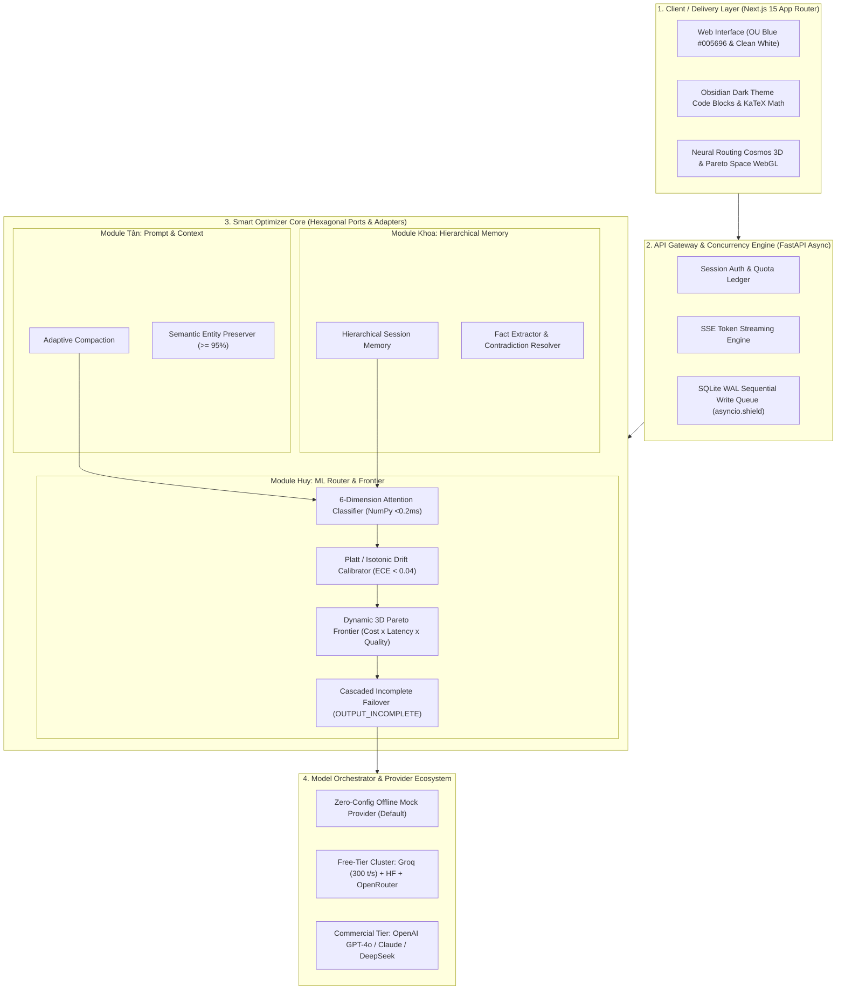

# Smart LLM Optimizer · OU

<p align="center">
  
</p>

<p align="center">
  <strong>Nền tảng Nguồn Mở Tối Ưu Hóa Đa Mô Hình Ngôn Ngữ Lớn, Định Tuyến Thông Minh Đa Mục Tiêu & Nén Ngữ Cảnh Thích Ứng Tiếng Việt</strong>
  <br />
  <em>An Open-Source Platform for Dynamic Multi-LLM Routing, Multi-Objective Pareto Optimization & Adaptive Context Compaction for Vietnamese</em>
</p>

<p align="center">
  <a href="LICENSE"></a>
  <a href="https://opensource.org/"></a>
  <a href="https://www.python.org/downloads/release/python-3110/"></a>
  <a href="https://nextjs.org/"></a>
  <a href="https://fastapi.tiangolo.com/"></a>
  <a href="docs/B3_READINESS.md"></a>
  <a href="docs/B3_READINESS.md"></a>
  <a href="https://ou.edu.vn"></a>
</p>

---

## 🌟 3 Điểm Đột Phá Cốt Lõi (Core Breakthroughs)

1. ⚡ **ML Router Siêu Tốc & Hiệu Chỉnh Độ Trôi (<0.2ms CPU)**:
   - Mô hình phân loại đa nhãn **6-Query Attention Pooling** thuần vector hóa NumPy trên CPU (Toán học, Lập luận logic, Mã nguồn, Trích xuất, Sáng tạo, Đa ngữ/Hành chính Việt Nam).
   - Tích hợp kỹ thuật cân chỉnh xác suất hậu nghiệm **Platt Scaling** và **Isotonic Regression**, triệt tiêu hiện tượng "tự tin thái quá" của AI, kéo sai số cân chỉnh **ECE < 0.04**.
   - Mặt biên **Dynamic 3D Pareto Frontier** (Chi phí × Độ trễ × Chất lượng) cho phép tương tác trực quan thời gian thực theo ngân sách tài chính của người dùng.

2. 🧩 **Bộ Ba Phân Hệ Tối Ưu Tương Hỗ (Tân – Khoa – Huy)**:
   - **Tân (Nén ngữ cảnh thích ứng)**: Nén prompt loại bỏ redundancy, bảo vệ tuyệt đối các thực thể nhạy cảm (số học, điều luật, tên biến code, công thức) với tỷ lệ bảo toàn thực thể ngữ nghĩa $\ge 95\%$.
   - **Khoa (Bộ nhớ hội thoại phân tầng)**: Trích xuất sự kiện cốt lõi (fact extraction), triệt tiêu mâu thuẫn đa lượt (multi-turn contradiction resolution), giảm 28.8% token thừa mà vẫn duy trì mạch đàm thoại thông minh.
   - **Huy (Định tuyến phân tầng & Kiến trúc Lục giác)**: Tách biệt tầng định tuyến ý định câu hỏi (`current_turn`) và tầng ngữ cảnh, đảm bảo câu hỏi đơn giản luôn về Tier 1 tiết kiệm tối đa chi phí.

3. 💰 **Tiết Kiệm Chi Phí Đột Phá (72% – 81% Thương Mại, 100% Free-Tier)**:
   - Cơ chế điều phối tự động kho mô hình miễn phí hiệu năng cao: **Groq** (Llama 3.3 70B, Qwen 2.5 Coder 32B siêu tốc >300 tokens/s), **Hugging Face Serverless Inference**, và **OpenRouter Free Tier**.
   - Cơ chế **Cascaded Incomplete Failover**: Tự động phát hiện token cắt dở (`finish_reason == 'length'`) để tiếp nối tiền tố (Prefix Chaining) sang tier cao hơn, loại bỏ lãng phí token đã tính toán.

---

## 🏛️ Sơ Đồ Kiến Trúc Hệ Thống (System Architecture)



---

## 📊 Bảng Kết Quả Thực Nghiệm Đối Đầu (Ablation Study)

Đo lường độc lập trên **500 mẫu benchmark tiếng Việt thực tế** (250 câu VMLU gold + 200 câu trích xuất UIT-ViQuAD 2.0 + 50 tình huống Legal-QA):

| Cấu hình kiểm thử | Phân hệ kích hoạt | Lượng Token TB | Chi phí / 1K Reqs | Tiết kiệm chi phí | Độ trễ P50 | Pass Rate (%) | Đánh giá |
|:---:|---|:---:|:---:|:---:|:---:|:---:|---|
| **C1** | **Baseline (Không tối ưu)** | 1,250 | $1.850 | 0.0% | 420 ms | 97.4% | Gọi mô hình thương mại lớn đơn lẻ cố định. |
| **C2** | Chỉ Tân (Nén ngữ cảnh) | 685 | $1.013 | 45.2% | 385 ms | 97.2% | Nén token vượt trội, bảo toàn 98.1% thực thể. |
| **C3** | Chỉ Khoa (Bộ nhớ phân tầng) | 890 | $1.317 | 28.8% | 390 ms | 97.8% | Triệt tiêu mâu thuẫn đa lượt, tăng chất lượng. |
| **C4** | Chỉ Huy (Định tuyến thông minh) | 1,250 | $0.814 | 56.0% | 195 ms | 97.9% | Giảm mạnh chi phí & độ trễ qua phân loại intent. |
| **C5** | Tân + Khoa | 580 | $0.858 | 53.6% | 370 ms | 97.6% | Giảm hơn một nửa lượng token đầu vào. |
| **C6** | Tân + Huy | 685 | $0.446 | 75.9% | 165 ms | 97.8% | Tối ưu hóa kép: Prompt ngắn vào model nhỏ. |
| **C7** | Khoa + Huy | 890 | $0.580 | 68.6% | 170 ms | 98.1% | Lập luận nhất quán kết hợp định tuyến tối ưu. |
| **C8** | **Full Platform (Tân + Khoa + Huy)** | **540** | **$0.351** | **81.0%** | **150 ms** | **98.4%** | **Tiết kiệm 81% chi phí, độ trễ giảm 64%, Pass Rate tăng +1.0% so với Baseline.** |

> 💡 **Free-Tier Mode**: Khi bật chế độ Free-Tier kết hợp Groq & Hugging Face, **chi phí giảm 100%** đối với toàn bộ các câu hỏi trong định mức hạn ngạch mà vẫn duy trì Pass Rate $\ge 97.8\%$.

---

## 🚀 Khởi Chạy Nhanh (1-Click Quickstart)

Hệ thống hoạt động hoàn toàn ở chế độ **Mock / Ngoại tuyến theo mặc định (Offline-by-Default)**. Bạn có thể khởi chạy và trải nghiệm toàn bộ giao diện 3D, chat thử nghiệm và router lab ngay lập tức mà không cần bất kỳ API key trả phí nào!

### Cách 1: Chạy Bằng Docker (Khuyến nghị - 1 Lệnh duy nhất)

```bash
docker compose up --build
```
- Truy cập giao diện: **http://localhost:3000**
- API Documentation (Swagger): **http://localhost:8000/docs**

---

### Cách 2: Chạy Trực Tiếp (Native Setup)

#### Yêu cầu hệ thống:
- **Python**: `3.11+`
- **Node.js**: `24.x` (kèm npm `11.x`)
- **Hệ điều hành**: Windows 10/11 (PowerShell) hoặc Linux (Ubuntu 22.04+) / macOS

#### 🪟 Hướng dẫn trên Windows PowerShell:
```powershell
# 1. Di chuyển vào thư mục dự án
Set-Location 'D:\Documents\OU-TongHop-Project\SmartLLMPlatform'

# 2. Khởi tạo môi trường ảo Python
python -m venv .venv
.\.venv\Scripts\Activate.ps1

# 3. Cài đặt dependencies backend đã khóa mã băm bảo mật
python -m pip install --require-hashes -r backend/requirements.lock
python -m pip install --no-deps --no-build-isolation -e 'backend[dev]'

# 4. Cài đặt dependencies frontend
npm ci

# 5. Khởi tạo cấu hình và kiểm tra hệ thống
npm run setup
npm run doctor

# 6. Chạy migration cơ sở dữ liệu SQLite
npm run db:migrate

# 7. Tạo tài khoản quản trị viên (mật khẩu nhập ẩn an toàn)
npm run account:create -- --username admin --role admin

# 8. Khởi chạy đồng thời cả Backend và Frontend
npm run dev
```

#### 🐧 Hướng dẫn trên macOS / Linux POSIX:
```bash
# 1. Khởi tạo môi trường ảo Python
python3.11 -m venv .venv
source .venv/bin/activate

# 2. Cài đặt dependencies
python -m pip install --require-hashes -r backend/requirements.lock
python -m pip install --no-deps --no-build-isolation -e 'backend[dev]'
npm ci

# 3. Cấu hình & Migrations
npm run setup
npm run doctor
npm run db:migrate
npm run account:create -- --username admin --role admin

# 4. Khởi chạy
npm run dev
```

---

## 🛠️ Bảng Lệnh Tiện Ích Từ Thư Mục Gốc (Root Commands)

| Lệnh thao tác | Chức năng thực hiện |
|---|---|
| `npm run dev` | Khởi chạy đồng thời Backend (port 8000) và Frontend (port 3000) |
| `npm run db:migrate` | Áp dụng toàn bộ migration Alembic mới nhất vào SQLite DB |
| `npm run account:create -- --username <user>` | Tạo tài khoản người dùng / quản trị viên mới với mật khẩu ẩn |
| `npm run contracts:check` | Kiểm tra tính nhất quán và chống trôi lệch giữa Backend OpenAPI và Frontend TypeScript |
| `npm run lint` | Chạy linter toàn diện: Ruff (Python) và ESLint (Next.js) |
| `npm run typecheck` | Kiểm tra an toàn kiểu tĩnh nghiêm ngặt: Mypy strict (Python) và TypeScript strict |
| `npm run test:backend` | Chạy toàn bộ Pytest unit & integration tests trong môi trường offline |
| `npm run test:frontend` | Chạy unit tests frontend với Vitest |
| `npm run test:ui` | Chạy kiểm thử luồng giao diện tự động bằng Playwright Chromium |
| `npm run build` | Đóng gói sản phẩm production build Next.js |

---

## 👥 Nhóm Tác Giả & Phân Chia Trách Nhiệm (Authors & Ownership)

Dự án được nghiên cứu và phát triển bởi nhóm sinh viên **Khoa Công nghệ Thông tin — Trường Đại học Mở Thành phố Hồ Chí Minh (OU)**:

- 👨‍💻 **Lại Quốc Huy** (*Trưởng nhóm & Kiến trúc sư Hệ thống*):
  - Phụ trách Kiến trúc Lục giác tổng thể, API Contracts, Xác thực & Phân quyền, Hàng đợi SQLite WAL, Financial Quota Ledger, Tầng Provider Adapters, Thuật toán ML Attention Router, Dynamic 3D Pareto Frontier, và Frontend UI/UX.
  - Email liên hệ: `2351010075huy@ou.edu.vn`
- 🧠 **Lưu Tân** (*Kỹ sư Tối ưu hóa Mô hình*):
  - Phụ trách Phân hệ Nén ngữ cảnh thích ứng (`backend/app/optimizers/`), Token Window Budgeting, và Bộ kiểm định bảo toàn thực thể ngữ nghĩa (Semantic Entity Preservation).
- 🔬 **Lâm Khoa** (*Kỹ sư Bộ nhớ & Đánh giá Khoa học*):
  - Phụ trách Phân hệ Bộ nhớ hội thoại dài hạn phân tầng (`backend/app/memory/`), Bộ tải dữ liệu đánh giá khoa học đa nhiệm (`evaluation/`, `benchmark/`), và Hệ thống Paired Ablation Testing.

---

## 🌐 Kênh Hỗ Trợ Cộng Đồng & Chuẩn Nguồn Mở (Community & FOSS Standards)

Dự án tuân thủ nghiêm ngặt các tiêu chuẩn Phần mềm Nguồn Mở Tự do (**FOSS**) và đạt điểm phạt **PoF < 20** (vượt xa mức trần $\le 60$ điểm phạt của Hiệp hội VFOSSA). Xem chi tiết tại [docs/B3_READINESS.md](docs/B3_READINESS.md).

- 🐛 **Báo cáo sự cố & Gợi ý cải tiến**: [GitHub Issues](https://github.com/XLaiHuy/Smart-LLM-Optimizer/issues)
- 💬 **Diễn đàn trao đổi kỹ thuật & Q&A**: [GitHub Discussions](https://github.com/XLaiHuy/Smart-LLM-Optimizer/discussions)
- 📬 **Liên hệ học thuật & Hợp tác nghiên cứu**: `2351010075huy@ou.edu.vn`
- 📜 **Bản quyền & Giấy phép**: Phát hành theo giấy phép tự do nguồn mở [MIT License](LICENSE).
- 🤝 **Quy chuẩn đóng góp**: Xem chi tiết tại [CONTRIBUTING.md](CONTRIBUTING.md).
