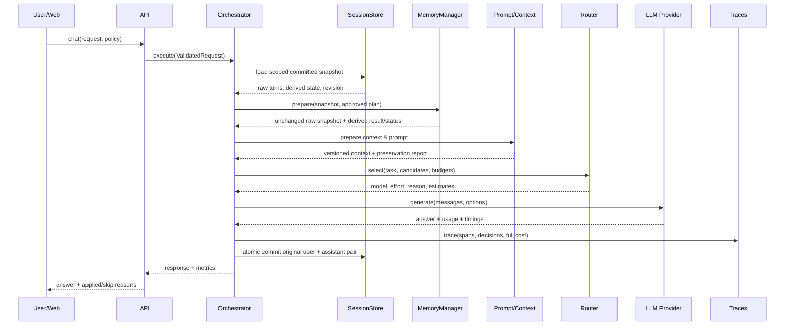
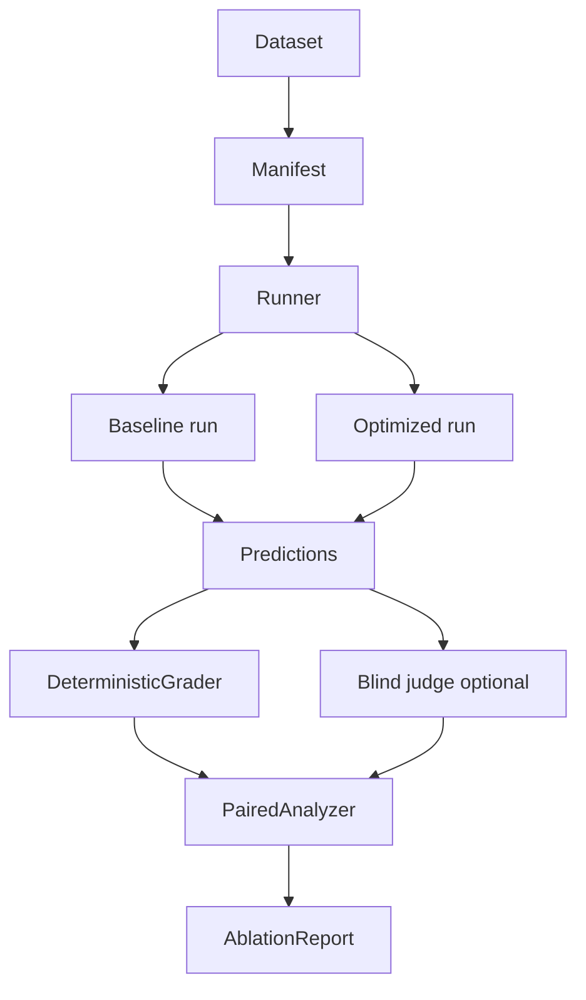

# SMART LLM OPTIMIZER — DESIGN SPEC V3

Cập nhật G0 ngày 2026-10-20. Giữ tên file V2 để bảo toàn liên kết; nội dung là **Design Spec V3**. Workspace nay có implementation foundation G0 và generated OpenAPI/TypeScript. Optimizer algorithms, qualification manifests và scientific benchmark vẫn thuộc gates sau; live adapter/documents/analytics đã có implementation theo §15, paid pilot chưa được xác nhận; không suy từ mock thành kết quả nghiên cứu. Xem [README](README.md) và [G0 handoff/evidence](docs/G0_HANDOFF.md) cho trạng thái kiểm tra thực tế, ownership và limitations.

## Changelog V2 → V3 (cập nhật 20/10/2026)

- **22/10/2026 — Lab thống nhất và tiến trình chat:** §19 thay cách nhúng Router Lab nâng cao và journey dưới câu trả lời; thêm progress port/API, migration `f105`, cửa sổ xem lại, reveal cuộn hai chiều và hồ sơ B3/PoF. [Handoff](docs/COMPACT_EXPERIENCE_HANDOFF.md).

- **21/10/2026 — UI/usage và bằng chứng:** landing tải phần workspace theo nhu cầu, các mục dưới hiện dần khi cuộn; VI/EN, trạng thái tương tác và sơ đồ từng câu trả lời theo trace thật. Usage thêm giờ/ngày/tháng, filter model/hội thoại, cảnh báo 80%/100% hạn mức; admin chỉ xem tổng hợp theo tài khoản. Migration `e104` lưu thời gian độc lập nội dung trace. Xóa kết quả ablation gán cứng; có file dữ liệu không đồng nghĩa qualified. Ước tính benchmark chỉ dành cho admin qua report đã duyệt + gate tắt mặc định; không gọi thêm model cho chat. Chi tiết API, migration, điều kiện report và evidence ở [UX/Usage handoff](docs/UX_USAGE_HANDOFF.md).

- **21/10/2026 — Optimizer Lab readiness UI:** `/research` đổi điểm vào thành Thử nghiệm hiệu năng, giữ Router Lab ở phần nâng cao. API admin `/v1/research/lab` trả readiness; prompt/memory, quy mô 50/200/600 và chạy ablation bị khóa khi chưa có thuật toán/dữ liệu qualified. Không tạo savings/charts giả. Chat hỗ trợ rich text an toàn, typography dễ đọc, nhãn chi tiết tối ưu VI/EN. Đợt này chưa hiện thực runner ablation; hướng dẫn và evidence kiểm thử gọn ở [handoff](docs/PLATFORM_V2_HANDOFF.md).

- **21/10/2026 — Hiệu chỉnh hybrid research candidate:** bổ sung grouped OOF (TF-IDF fit riêng từng fold), compiler giữ precision và semantics float32, validate cây/bounds, fallback có kiểm tra feasibility. Hybrid dùng feature version `intent-recent-rag-hybrid-oof-v3`; artifact hybrid thử nghiệm cũ phải train lại. CLI `train --hybrid/--no-hybrid`, linear mặc định, `evaluate --compare-model` trên cùng HOLDOUT độc lập. Lab đọc importance hai predictor từ frozen run; không gọi đó là giải thích từng câu hoặc xác suất đúng. Không có bằng chứng SOTA/quality/savings/latency live. Xem [handoff cập nhật](docs/PLATFORM_V2_HANDOFF.md).

- **21/10/2026 — Ba model, tools nội bộ và landing:** §17 bổ sung `ml_multi_model`, data-only artifact V2 (giữ V1), Responses continuation, hai tools có giới hạn, recovery lượt sau và public platform metadata. Migration `d103_tools` additive. Đây là mở rộng thay quyết định cũ hoãn toàn bộ tools; chỉ calculator và tra cứu nguồn đã chọn được phép. Local LLM, framework agent và thực thi mã vẫn hoãn. [Handoff V2](docs/PLATFORM_V2_HANDOFF.md) là nguồn trạng thái kiểm thử; chưa có kết quả tiết kiệm/chất lượng live.

- **21/10/2026 — Lightweight ML router:** TF-IDF word/char + numeric + logistic regression offline; DEV train/calibration độc lập và HOLDOUT evaluate; artifact JSON data-only đóng băng theo run. Policy `ml_router` chấm cặp candidate/reference đúng identity; fallback vẫn qua feasibility/ledger. Chat Tự động/Chuẩn, lý do VI/EN; simulation không chứng minh quality/cost. Default strategy vẫn `rule_guarded`, gate ML live tắt. Xem [ML handoff](docs/ML_ROUTER_HANDOFF.md); chưa có qualified training data, paid pilot hoặc artifact nghiên cứu. Mở rộng nghiên cứu có kiểm soát của Huy này thay phần loại trừ learned router cũ khi qua gates; không sửa benchmark/graders của Khoa hay optimizer của Tân.

- **Huy Router Lab:** thêm §16 cho registry validation/capabilities, audited reconciliation, router P0 và research UI/CLI độc lập bằng 20 fixtures. Simulation mặc định, batch live cần server gate riêng; chưa paid pilot hoặc scientific G2/G3 evidence. Làm việc theo `feature → develop → main`.

- **G0 implementation:** foundation backend/frontend/SQLite, typed no-ops/mock, auth/history/ledger/trace/overview, CLI/smoke, locks/CI và handoff. Chuyển UI sang trắng–xanh OU `#034EA2`/`#387EC1`, Roboto local, Việt/Anh. Thêm `GET /v1/overview`; setup Windows, localhost-only, chưa Docker/live adapter. Evidence/giới hạn ở `docs/G0_HANDOFF.md`; Linux CI chưa chạy remote.

- Khóa MVP FastAPI + Next.js + SQLite WAL trên laptop, API server-side; local LLM, tools/agents và Docker để sau.
- Khóa admin-created accounts, shared server key, owned history/trace và quota request/user/project.
- Hiệu chỉnh V3 trước skeleton: §04 là nguồn chuẩn DTO/ports; Memory no-op giữ snapshot, SessionStore lưu thật; một nơi assemble messages; ledger độc lập price catalog; metrics unknown/null và trạng thái no-op rõ.
- Đồng bộ ownership: Huy core/backend/router/wiring/frontend; Tân prompt/context/preservation; Khoa memory/evaluation. Tân/Khoa tách feature branches sau toàn bộ G0; estimate G0 1–2 ngày để lập lịch, không cam kết ngày đầu hay không có conflict.
- G0 có nền tảng thật, deterministic mock provider, optimizer no-op và UI hoàn thiện; live adapter/classifier/thuật toán thật thuộc gate sau. G0 checklist đối chiếu evidence ở handoff; live research chưa chạy.
- Bốn target suites Việt-first vẫn phải qualification. 140–170 là tổng đơn vị DEV + HOLDOUT, không bảo đảm statistical power hay giá API; pilot chọn call matrix trong envelope khoảng 20 USD. Probes chuyển thể từ hội thoại công khai phải có provenance/review.
- Đồng bộ hướng dẫn tại `.agents/skills/` và [Master Prompt G0](docs/SKELETON_MASTER_PROMPT.md); Master Prompt lưu brief G0, không dùng để scaffold đè implementation hiện tại.

**Quy ước trạng thái:** `LOCKED` = quyết định sản phẩm/kiến trúc đã thống nhất; `PROPOSED` = tham số/giả thuyết cần khóa trước thí nghiệm; `CANDIDATE` = nguồn/cấu hình đang được xem xét; `QUALIFIED` = đã kiểm tra dữ liệu, grader, quyền sử dụng và khả năng chạy theo protocol; `IMPLEMENTED` = chỉ dùng khi có code và bằng chứng kiểm tra. Nguồn đã đọc không tự động là `QUALIFIED`; V3 là đặc tả; evidence triển khai G0 ở handoff, các nghiên cứu chưa được suy ra từ mock.

# 00 — Decision Record & Definition of Success

## 0.1. Đề gốc (source-derived)
> Xây dựng nền tảng hỗ trợ lựa chọn mô hình AI, tối ưu prompt, rút gọn ngữ cảnh và quản lý lịch sử hội thoại nhằm giảm lượng token, chi phí và thời gian phản hồi mà vẫn duy trì chất lượng đầu ra.

Theo form nộp do người dùng cung cấp: cần kho mã nguồn, giấy phép nguồn mở và slide PDF; link triển khai được khuyến khích, README/cài đặt, PPTX và video là tùy chọn. **Chưa có rubric/barem chi tiết**; tính mới, cách tiếp cận và kết quả là kỳ vọng của đội, chưa phải trọng số chấm chính thức. Yêu cầu dùng thư viện mã nguồn mở không tự suy ra mọi model phải chạy offline.

## 0.2. Kiến trúc được chọn (team proposal, không phải yêu cầu BTC)
`LOCKED`: một **modular-monolith LLM Optimization API**, một **evaluation harness**, một **web dashboard**. Python 3.11+/FastAPI/Pydantic V2 backend, TypeScript/Next.js frontend, SQLite cho MVP local trên laptop. Provider live là OpenAI native adapter; OpenAI-compatible wrapper là P1. Next.js chỉ làm UI/proxy, nghiệp vụ nằm ở FastAPI. Contracts trước feature; PostgreSQL là hướng nâng cấp theo tải, không phải một deployment phải làm song song.

## 0.3. Phạm vi sản phẩm
**Must / P0:** (a) nhiều model/config có thể chọn; (b) prompt rewriting có kiểm tra preservation và skip; (c) context selection + summarization/compaction; (d) raw/history/summary tách biệt, server quản lý history; (e) baseline/quality-cost-latency dashboard; (f) local dev reproducible; (g) OSS/license audit; (h) nhiều tài khoản do admin tạo, shared API key phía server, quyền sở hữu session/trace/report; (i) controller tối thiểu quyết định apply/skip và quản lý ngân sách request/user/project. Xem mức hoàn thiện skeleton ở `14`, không đồng nhất skeleton với MVP tối ưu hoàn chỉnh.

**Should / P1:** confidence-aware cascade sau generation, failure retry/fallback nâng cao, exact cache, streaming/TTFT. Kiểm tra budget và quay về baseline trước generation khi chất lượng ứng viên chưa xác nhận là P0.

**Won't (MVP):** training foundational MoE, sửa repository/chạy shell qua coding agent, custom Kubernetes, fine-tune router, full RAG platform, tool execution/agent loops, local LLM/GPU serving, BYOK, tự đăng ký/OAuth/khôi phục mật khẩu. Đội có RTX 5060 Ti 16 GB VRAM nhưng đã chọn để local model sau MVP.

## 0.4. North-star + guardrails
`LOCKED`: **minimize expected all-in serving cost**, subject to quality theo từng nhóm tác vụ, hard constraints, capabilities, ngân sách và quyền truy cập. Median latency của policy được chấp nhận không tăng quá **10%** so với baseline theo paired protocol. Ưu tiên sweet spot giảm cost, giữ/tăng chất lượng và giảm latency nếu có; không hứa tất cả chỉ số luôn cải thiện trên từng request. P95/error rate vẫn báo riêng.

**PROPOSED, cần khóa trước holdout:** cost saving ≥ 15%; δ_quality và metric riêng cho instruction-following, QA/reasoning và memory; 3 percentage points là điểm khởi đầu cho metric accuracy, chưa phải ngưỡng đã được người dùng chốt cho mọi nhóm. Không dùng ngưỡng giảm 5 pp cho một domain để che vi phạm ngưỡng nhóm đã khóa. Hard-case regression phải có 0 vi phạm quan sát được; đây là acceptance trên bộ đó, không phải bảo đảm lỗi bằng 0 ngoài thực tế. Báo `PASS_OBSERVED`, `INSUFFICIENT_EVIDENCE` hoặc `FAIL` theo quy tắc ở `06`.

**Quality uncertainty / LOCKED:** nếu chưa đủ bằng chứng cho model/policy tối ưu ở nhóm tác vụ hiện tại, quay về cấu hình tham chiếu với **original prompt + full raw history**, bypass optional transformations chưa được xác nhận. Chỉ thực hiện nếu baseline còn hợp lệ và đủ remaining budget/deadline; nếu không thì trả lỗi tương ứng, không tự best effort. Nếu đã có optimizer calls trước khi phát hiện uncertainty thì vẫn tính các calls đó trong tổng cost/latency; không giả làm fast path miễn phí. Chất lượng baseline cũng là số đo theo workload, không phải bảo đảm đúng cho từng câu.

**Definition of Success:** live baseline + 2+ non-identical candidate model configurations; benchmark paired reproducible; ít nhất 2 modules tối ưu có ablation độc lập; e2e logs có cost/latency/quality; demo hiển thị trường hợp optimizer chọn skip vì overhead; đội thuyết trình được giới hạn phương pháp.

## 0.5. Scope gates theo thứ tự
`G0 runnable foundation + contracts freeze → G1 evaluation executable → G2 baseline real → G3 routing tested → G4 prompt tested → G5 context tested → G6 memory tested → G7 combined controller → G8 end-to-end benchmark → G9 submission`. Chi tiết ở `05`, `07`, `14`. Controller apply/skip/budget xuất hiện từ G0/G2; G7 kiểm chứng policy kết hợp, không phải lúc mới bắt đầu xây orchestrator.

**Quan trọng:** G0–G2 phải hoàn thành trước G3–G6; G3, G4 và G5 có thể chạy song song sau G2 nếu dùng mocks/contracts và có owner tích hợp.

## 0.6. Những gì CHƯA biết cần hỏi BTC
Đã biết yêu cầu form ở `11`; còn cần xác nhận rubric, các giới hạn riêng về paid API/OSS/data và timezone chính thức của hạn nộp. Dùng Asia/Saigon làm timezone làm việc của đội. Không coi link triển khai hay video là bắt buộc khi form ghi tùy chọn.

## 0.7. Nguồn lực và model candidates

`LOCKED`: đội 3 người, mỗi người dự kiến từ 5 giờ/ngày trong khoảng một tuần; ngân sách API dự kiến tối đa khoảng **20 USD** cho phát triển/eval/chạy lại đến hạn. Chi tiêu thực tế phải gồm optimizer calls và offline judging; pilot xác định số mẫu/cấu hình khả thi trước khi khóa ma trận.

`CANDIDATE`: `gpt-6-luna`, `gpt-4o-mini`, `gpt-5.6-terra`, `gpt-5.6-luna` do người dùng chọn. Có API key không đồng nghĩa đã kiểm tra mọi model/quota. A xác nhận model_id, endpoint, capabilities, usage, service tier và giá tại thời điểm chạy. Không suy ra model cũ rẻ hơn hoặc Terra mạnh hơn Luna trên mọi tác vụ; vai trò baseline/candidate được xác định từ DEV, kể cả khi router cuối cùng chủ yếu chọn một model. Nguồn API ở `90`; không cần gửi secret vào tài liệu.


---

# 01 — Product Requirements / Business Analysis / Domain

## 1. Actors, jobs-to-be-done
- **End user:** chat, chọn optimize on/off, xem câu trả lời, lịch sử, restore session.
- **Experimenter / Researcher:** vai trò admin trong MVP; quản lý suites/splits/configs qua eval CLI, xem per-case delta; user thường không được chạy batch trả phí.
- **Admin / Developer:** tạo tài khoản bằng CLI, cấu hình registry/quota/policy, xem báo cáo nghiên cứu và disable feature. Quyền admin không tự động cấp quyền đọc hội thoại riêng của mọi user.
- **External application:** đăng nhập và gọi API stateful theo quyền user, gửi `client_request_id` để dedupe; không upload toàn bộ history trong MVP.

## 2. Use Cases (Use Case ID → precondition → outcome → exception)
- UC01 Chat baseline: model pinned + original prompt + complete eligible context → response và usage đã đo. Thiếu model key → báo lỗi cấu hình, không chế số liệu.
- UC02 Optimize chat: `policy_id`, optional `flags`; controller áp dụng precedence ở `04`, chỉ chạy module đủ điều kiện → response + applied/skip reasons + all-in costs.
- UC03 Choose model automatically: registry có ≥ 2 model/cấu hình hợp lệ; chọn theo quality/budget constraints; nếu thiếu capability → explain refusal/fallback.
- UC04 Rewrite prompt: lưu raw và rewritten; giữ system/developer instructions bất biến; preserve language, format, named entities, constraints; nếu không chắc → skip.
- UC05 Compact context: giữ current user + pinned facts + safety/instruction hierarchy; vượt budget → selection/retrieval/compression; source mapping.
- UC06 Manage history: create/list/resume/delete session; raw immutable turns, summaries có version/provenance; user-scope isolation.
- UC07 Compare baseline vs optimized: cùng input/cases, temperature/seed tương đương khi được provider hỗ trợ; hiển thị metrics theo task/length/difficulty.
- UC08 Run benchmark: admin chạy eval CLI với manifest, splits/config/pricing/concurrency → JSONL và report. Mock được phép cho smoke chức năng, bị chặn khỏi live scientific results; benchmark dùng namespace riêng.
- UC09 Rollback policy: deactivate flag; preserve request trace; never expose secret/API key.
- UC10 External integration: login → create session → POST lượt mới → GET trace/history theo auth. Report nghiên cứu chỉ admin. API version `/v1` được thiết kế mới, chưa có consumer cũ để migrate.
- UC11 Account/quota: admin tạo user; user đăng nhập/đăng xuất và có quota riêng. Hết quota → từ chối trước paid call; không dùng quyền/ID do client tự khai.

## 3. Functional acceptance matrix

Đây là target của MVP hoàn chỉnh qua nhiều gates; G0 dùng subset/mock/no-op theo §14.8, không phải mọi FR nghiên cứu đã triển khai ngay trong foundation.

| FR | Required behavior | Acceptance |
|---|---|---|
| FR01 | Configurable registry | 2 model entries + caps/price/source/version; reject missing capability |
| FR02 | Baseline raw pass-through | Golden request assembled unchanged; exact provider usage stored |
| FR03 | Route policies | pinned, rule, budget-aware; decision rationale; unit fixtures |
| FR04 | Prompt rewrite | raw preserved; protected regression pass; báo attempted/applied/skip và preservation cùng chất lượng đầu ra; không coi 95% là đủ cho hard constraints |
| FR05 | Context budget | preflight budget and guard against overflow; priority order documented |
| FR06 | Memory | full session save/resume/delete; no cross-user retrieval |
| FR07 | Cost/latency | end-to-end walltime plus per-stage spans; verify additive accounting |
| FR08 | Benchmark | run 4+ configurations on identical cases; deterministic grading preferred |
| FR09 | Feature flags | bypass each module; no hidden side-effect when disabled |
| FR10 | UI | baseline/optimized comparison, history, per-run metrics, skip reasons |
| FR11 | Accounts/ownership | admin-created login/logout; user không đọc/xóa session, summary, trace của user khác |
| FR12 | Budget/dedupe | ledger request/user/project; concurrent request không vượt reservation; ID lặp không tạo paid call mới |

## 4. Nonfunctional requirements
- Security: only allowlisted providers; secrets environment not in logs; max payload; PII redaction; tenant/user isolation; timeout and bounded retry.
- Performance: fast path (simple request with modules skipped) should add negligible Python overhead. **Measure**, don't assert arbitrary <100ms targets without tests.
- Reliability: at-least-once provider call caution; request dedupe if supported; disabled module must truly bypass calls.
- Traceability: code SHA, experiment/config versions, response ID, model ID, tokenizer variant, policy decisions.
- Portability: local `npm run dev` + `uvicorn`; mock works offline for UI, but benchmark requires provider/mock distinction.
- Maintainability: A owns schema/migrations/storage adapters; modules dùng repository ports, DTOs/interfaces chuẩn trong `backend/app/contracts/`; ownership chi tiết ở `14`.
- Accessibility: visible text comparison, downloadable CSV/JSON for judges.

## 5. Explicit edge cases
Empty prompt, 100k characters, Unicode Vietnamese, hidden JSON-only requirements, user changing language mid-session, code fences, prompt containing fake system instructions, model rate limit, disconnected SSE, context very long, no relevant history, summary contradiction, stale model pricing, cache privacy mismatch, model unavailable, duplicated retry, zero cached token usage, cost currency unknown.

## 6. Out of scope vs future
Coding tasks (read-only question answering or code snippet generation) là **candidate domain mở rộng khi có nguồn Việt/grader qualified**, không tự thuộc bốn primary suites hoặc cho phép mutate repository. Full coding harness có thể là integration riêng tiêu thụ optimizer API sau MVP.


---

# 02 — Glossary, Harness, MoE, Multi-agent & Related Research

## 1. Các thuật ngữ dễ nhầm
| Concept | Định nghĩa kỹ thuật | Target MVP / G0 status xem handoff |
|---|---|---|
| LLM Gateway | API wrapper chuẩn hóa provider/auth/usage/errors | Yes |
| Optimization Engine | Thuật toán chọn model/prompt/context để tối ưu objective | Yes |
| Orchestrator | Lập thứ tự, gọi component, skip, exception/fallback | Yes |
| AI/Agent Harness | Runtime quản lý agent-loop, tool calls, state, retries, permissions, observations, checkpoint | Minimal subset (state/policy), NO tool execution |
| Coding Agent | Harness + read/write repo/shell/tests/diff/rollback/LSP | No in MVP |
| Evaluation Harness | Dataset runner, repeat configs, grading, metrics, traces, reports | Yes; core differentiator |
| Mixture-of-Experts (MoE) | Internal sparse neural architecture routing tokens to expert subnets | No |
| Multi-LLM Routing | External selection of entire model/config per request | Yes |
| Cascading | Try cheaper model, decide when to fall back to stronger model | Should |
| Model Ensemble | N models produce outputs aggregated / voted | No MVP (costly) |
| Reasoning Effort | Provider-specific inference knob; NOT universal equivalent to thinking duration | Optional only when supported |
| Prompt Rewriting | Rewrite user/task prompt preserving intents/constraints | Yes |
| Token Compression | Remove/select/re-encode portions of prompt/context to reduce tokens | Yes selective |
| Context Summarization | Condense history/content into summary | Yes |
| Compaction | Trigger + workflow to replace eligible old context with compressed state | Yes |
| Semantic Cache | Reuse answer to semantically similar requests when safe | Future |
| Retrieval | Select memory chunks relevant to query; NOT equivalent full RAG platform | Optional |
| Ablation | Compare controlled variants with one component/policy changed | Mandatory |
| Pareto frontier | Non-dominated solutions among quality/cost/latency objectives | Mandatory reporting |
| SOTA | Best-known result under a specified, public benchmark/protocol; not synonym of "good" | Claim only with evidence |

## 2. MoE vs router (formal)
**Internal MoE:** within a learned network, input tokens x go to expert E_k under gating g(x), often trained jointly; p(y|x) mediated through hidden layers. **Our external router:** per request x, pick model/config m by policy π(x, context, SLO), invoke remote/local LLM m; resulting answer y. Router training optional and independent from model training.

Paper: Switch Transformers (Fedus et al., JMLR 2022); deployment routing: FrugalGPT (Chen et al., 2023), RouteLLM (Ong et al., 2024). Xem mục `90` ngay trong tài liệu; chưa có file nguồn tách riêng.

## 3. What an agent harness actually entails
A full harness needs planner/executor/tool registry, permission sandbox, shell/file operations, patch application, checkpoints, approval UI, compensation/rollback, conflict resolution, verification tests, traces and state transitions. This set is **distinct from the competition statement** and high-risk in 7–8 days. Only borrow composable concepts: typed actions, scheduler, budget controller, hooks, traces and policy flags.

## 4. How optimization differs from workflow automation
Optimizer chooses HOW to execute an existing inference task (model/context/prompt) while keeping task semantics. Agent decides WHICH tools/actions to perform across many steps. A constrained optimizer must not make hidden web requests, edit code, or silently re-interpret user intent.

## 5. Quality benchmark terms
Ground truth, reference answer, deterministic grader, judge rubric, judge agreement, paired evaluation, held-out set, calibration, leakage, data contamination, position bias, bootstrap CI, non-inferiority, TTFT, p50/p95 latency, throughput, prefill/decode, context budget, prompt cache vs result cache, marginal cost, infra cost.

## 6. Research questions worthy of a report
- RQ1 Can a low-overhead router beat always-large and always-small model baselines on cost at fixed quality?
- RQ2 Which prompts lose required constraints when rewritten? Do rules outperform LLM rewriting for short prompts?
- RQ3 Which context compression rate maintains long-history fact retrieval? Does selective retrieval outperform blind summarization?
- RQ4 Does combining routing and compression improve, or compound quality regressions?
- RQ5 Can uncertainty-aware fallback detect hard cases cheaply enough to pay for itself?

Research should be designed as falsifiable hypotheses and include negative outcomes; don't pre-label the system SOTA.


---

# 03 — System Architecture, Component Dependencies & Runtime Flows

## 1. Boundary / deployment choice
**Modular monolith backend**, một FastAPI worker + SQLite local (foreign keys, WAL, bounded busy timeout), một Next.js frontend và eval CLI. SQLAlchemy 2 + Alembic cho storage/migrations. Multi-account là P0 nhưng không tự suy ra production scale. Next.js proxy `/api/*` tới FastAPI, không nhân đôi auth hoặc business logic. Provider cloud qua API trong MVP; local serving/Redis/PostgreSQL là hướng nâng cấp, chưa phải dịch vụ cần dựng. Blueprint ở `14`.

## 2. Component dependency DAG
```
UI ─→ Next.js proxy ─→ FastAPI/auth ─→ Orchestrator
                                      ├── BudgetLedger (request/user/project)
                                      ├── SessionStore port ─→ SQLite adapter
                                      ├── TaskAnalyzer
                                      ├── PromptOptimizer ─→ PreservationValidator
                                      ├── ContextManager (selection/assembly)
                                      ├── MemoryManager (summary/facts policy)
                                      │      └── MemoryStore port ─→ SQLite adapter
                                      ├── ModelRouter ─→ Registry/CostCatalog
                                      ├── ResponseValidator
                                      ├── Provider port ─→ OpenAI/Mock
                                      └── TraceStore port ─→ SQLite adapter
EvalRunner ─→ same Orchestrator (isolated eval namespace), Grader, ReportWriter
```
**No cycles:** contracts/ports không import implementation. Orchestrator gọi typed ports; composition root là nơi duy nhất ghép implementation cụ thể. Tân/Khoa không import ORM/storage internals/provider SDK để bypass ports; không tự tạo cost formula hay DTO song song. Eval gold/reference/supporting facts chỉ tới grader, không tới serving policy. Không chỉnh policy từ kết quả held-out đang chạy.

## 3. Execution graph by request (logical, some steps skip)
1. Authenticate, validate request và ownership; resolve policy/flags; dedupe `client_request_id` trước provider call; tạo `request_id`/attempt và chiếm session lease.
2. Đọc raw history/snapshot đúng user và session revision; không giữ DB transaction trong khi chờ LLM. Baseline dùng raw history riêng, không kế thừa optimized summary.
3. Phân tích task từ input gốc; candidate-feasibility precheck và output reserve; controller chọn apply/skip. Quality unknown → baseline đã chọn nếu còn hợp lệ và đủ budget/deadline.
4. Kiểm tra ledger request/user/project; reserve trước mỗi paid call. Exact cache là P1/default off; nếu triển khai, check sau khi biết final model/options và prepared-context hash để tránh key mơ hồ.
5. Context chọn/assemble sơ bộ; Orchestrator yêu cầu MemoryManager chuẩn bị derived state từ scoped snapshot chỉ khi policy/budget cho phép. Mọi summary call đi qua cùng metered provider port; SessionStore chịu trách nhiệm load raw history.
6. Rewrite phần user được phép; preservation không chắc → dùng nguyên bản. Đưa approved current-content candidate về ContextManager assemble cuối, recheck feasibility; Orchestrator không append thêm user turn và không bỏ instructions/evidence bắt buộc để vừa cửa sổ.
7. Router chọn final config trong tập hợp hợp lệ; ghi candidate rejections, uncertainty/skip và ước tính. Recheck ngân sách trước generation.
8. Generation non-streaming trong P0, bounded timeout; ghi usage/response ID, settle ledger. `ttft_ms=null` khi không đo streaming; không suy từ walltime.
9. Deterministic validation đối với yêu cầu kiểm tra được. Post-generation cascade/retry là P1, tối đa một fallback nếu còn reservation/deadline; không tự dùng offline gold để validate online.
10. Commit nguyên tử cặp original-user/assistant thành công, tăng revision; persist trace/accounting. Attempt lỗi lưu riêng, không trộn vào committed conversation. Giải phóng lease. Offline quality do EvalRunner tính sau.

## 4. Baseline fast path
Original user prompt + full committed raw history + server instructions → pinned baseline model → response; không optimizer calls/rewrite/compaction/result cache. Auth, persistence, token guard và ledger vẫn hoạt động. Nếu không vừa context → `CONTEXT_OVERFLOW`, không ngầm truncate. Benchmark tách common-fit khỏi overflow; overflow so với recency baseline riêng. Chế độ compare dùng fork từ cùng snapshot, không chạy optimized trên history đã có câu trả lời baseline.

## 5. Pipeline ordering rationale
**Context selection before final route**, but route **context-window feasibility precheck** first using candidate metadata; avoid circular dependency: `CandidateFeasibility` computes permissible budgets then `ContextManager.prepare()` returns candidate-aware token lengths; Router finalizes. Prompt rewrite may affect length and should record both original and final token budgets. If selected model cannot fit after rewrite, reroute or refuse, never truncate protected instructions silently.

## 6. Runtime sequence (normal)


## 7. Offline eval (don't contaminate real users)


## 8. Storage, invariants, operational keys
Thiết kế tables: `users` (username/password_hash/role/status/quota), `auth_sessions` (token_hash/expiry/revocation), `sessions` (owner/revision/active_attempt), `messages` (committed append-only role/content/time/source), `request_attempts` (client_request_id/payload_hash/status), `summaries` (version/source message IDs), optional `pinned_facts`, `model_registry`, `price_catalog`, `runs`, `inference_calls`, `optimization_events`, `budget_reservations`, `eval_cases`, `eval_results`. Huy (A) sở hữu ORM/adapters/migrations; Khoa (C) sở hữu summary/fact algorithms qua ports. Foreign keys và access filters áp dụng ownership; `summary` không là source of truth. `runs` references code/config/data hashes và namespace `eval`, tách user chat. Đây là logical schema của MVP; G0 cần các bảng nền tảng/auth/history/attempt/ledger/trace và derived-state support tối thiểu, không bắt buộc tạo sẵn toàn bộ bảng nghiên cứu chưa dùng.

Unique key `(owner_user_id, client_request_id)` cùng canonical payload hash chống duplicate. Một active attempt/session; concurrent request trả 409. Attempt `pending|running|succeeded|failed|interrupted`; completed duplicate cùng payload trả response đã lưu, payload khác trả conflict, failed/interrupted duplicate không tự retry trả phí. Khi restart, running attempt chuyển interrupted và reservation chưa rõ giữ unknown để reconcile. Không tự suy ra provider chưa tính tiền.

- `run_id`: unique a single config×suite×seed (repeat id included).
- `request_id`: unique actual serving request.
- `call_id`: each LLM invocation, including rewrite, routing, fallback and summary.
- `policy_version`, `dataset_version`, `prompt_template_version`, `model_id` persisted.

## 9. Nonfunctional and boundaries
Secrets không vào trace/log. Raw content được lưu trong DB riêng theo chức năng history và retention/deletion đã công bố; log/trace metadata mặc định không có raw content, export benchmark chỉ admin và có scrub. Không redact source-of-truth history đến mức không resume được. Xóa session purge messages/summaries/facts/cache/content-bearing attempts; accounting còn giữ chỉ metadata tối thiểu đã loại nội dung. Context/fallback chỉ dùng allowlisted models; retrieved content không được nâng thành privileged instructions. Cache default off, và không dùng chung giữa users/sessions.


---

# 04 — Module Contracts & API Specification (contracts nền và target nghiên cứu; mở rộng tại §15)

## 1. Immutable DTOs & compatibility
Pydantic V2 DTOs và typed ports đặt trong `backend/app/contracts/`, Huy (A) điều phối thay đổi. FastAPI OpenAPI sinh frontend TS types bằng openapi-typescript, Huy chạy generator và commit artifact khi schema đổi; không sửa types sinh tự động bằng tay. API mới dùng prefix `/v1`, không có V1 code cũ để migrate. Sau freeze, additive optional fields được review; breaking change phải cập nhật producer/consumer/tests trong cùng PR. Interfaces async nếu I/O, sync cho pure logic; input gốc immutable.

### Request V3 (illustrative)
```json
{
  "session_id": "session-001",
  "client_request_id": "3cc71375-1c84-4f49-9e9e-186494cdf401",
  "message": "Tóm tắt nội dung đã trao đổi thành 3 ý bằng tiếng Việt.",
  "mode": "optimized",
  "policy_id": "quality-guarded-v3",
  "flags": {"router": true, "rewrite": true, "context": true, "memory": true},
  "constraints": {"max_total_usd": 0.02, "deadline_ms": 15000}
}
```
`session_id`, `client_request_id`, non-empty `message`, `mode` bắt buộc. `mode` là `baseline|optimized`; `policy_id`, `flags`, `constraints` là optional, lấy default server. Client chỉ gửi lượt mới; full history, `user_id`, privileged roles, arbitrary provider params và `experiment_id` không phải input public của chat MVP. Server tự xác định user từ auth, nạp committed history và server instructions. EvalRunner dùng internal DTO chứa original messages/namespace riêng để replay, không mở cửa upload trusted roles cho user thường.

### Precedence và semantics / LOCKED

1. Auth/ownership/capability constraints, server kill switches, quota và project budget luôn có hiệu lực; client không nới được.
2. `mode=baseline` chọn server baseline config và tắt router/rewrite/context compaction/memory optimization/cache/cascade. Nếu client gửi flag true hoặc policy khác baseline thì trả 422; client bỏ flags/policy để dùng baseline defaults. History persistence, trace, validation và budget guard vẫn chạy.
3. `mode=optimized` resolve allowlisted `policy_id` theo deployment: G0 mock mặc định `foundation-mock-v3`; sau G2 live mặc định `quality-guarded-v3` chỉ khi policy đã được cấu hình/kiểm tra. Optional flags chỉ ghi đè module mà policy cho phép và implementation đã sẵn sàng. Flag bật feature P1 chưa triển khai bị từ chối. Ngoại lệ integration-only: `foundation-mock-v3` chỉ dùng với mock provider, cho exercise optimizer no-ops và trả `not_implemented`; không hợp lệ trong live mode/research. Baseline model/config và thresholds do admin config, không do tên model client tự gửi.
4. `flags.memory=false` tắt summary/fact retrieval, không tắt lưu/resume raw history. Không user flag nào tắt auth/accounting/preservation bắt buộc.
5. Cost/deadline effective là giới hạn chặt nhất của request, policy và server; reservation tính cả optimizer calls. Quality threshold lấy từ versioned policy/task-group profile đã hiệu chỉnh, không dùng một `min_quality_tier` string chưa có định nghĩa.
6. Request đang chạy trên cùng session → 409. Duplicate cùng ID/payload đã succeed → trả cùng response/request_id; khác payload hoặc attempt chưa succeed → 409 cùng trạng thái, không tạo provider call mới. Retry trả phí phải là attempt mới, chỉ sau khi trạng thái/usage cũ được ghi nhận.

### Response V3 (illustrative, một provider call)
```json
{
  "request_id": "request-001", "session_id": "session-001", "session_revision": 2,
  "execution_source": "live", "response": {"role":"assistant","content":"..."},
  "route": {"model_id":"configured-model", "effort":"none", "policy_id":"quality-guarded-v3", "reason":"baseline_quality_uncertain", "fallback_used":false},
  "usage": {"scope":"all_calls", "input_tokens":1200,"cached_input_tokens":0,"output_tokens":180,"reasoning_tokens":0,"usage_source":"provider"},
  "cost": {"scope":"all_calls", "status":"estimated", "serving_usd":0.001,"price_catalog_version":"example-v1"},
  "calls": [{"call_id":"call-001","stage":"provider","model_id":"configured-model","usage":{"input_tokens":1200,"output_tokens":180},"cost_usd":0.001,"cost_status":"estimated"}],
  "timing": {"e2e_ms":2000, "ttft_ms":null, "provider_ms":1850},
  "optimizations": [{"module":"rewrite","status":"skipped","reason":"under_threshold","before_tokens":1200,"after_tokens":1200}]
}
```
**Số liệu trên chỉ minh họa schema**, không phải giá/usage của model cụ thể hay test result. `usage`/`cost` top-level gồm mọi optimizer/provider/fallback call, không chỉ call cuối. `calls[]` giữ provider-native categories và usage_source để audit; aggregate nhiều tokenizer chỉ có ý nghĩa mô tả. Cost status: `known|estimated|unknown|not_billable`; nếu có một paid call chưa xác định cost thì tổng status unknown, `serving_usd=null` và có thể báo `known_subtotal_usd` riêng; không giả thành 0. Mock có `execution_source=mock`, `cost.status=not_billable`, `serving_usd=null`, usage ghi mock/estimated và không tham gia scientific savings. Non-streaming không có TTFT measurement.

Usage của một call thiếu trường không được bù bằng 0: trường aggregate tương ứng trả null/partial và giữ known subtotal/provenance riêng. `cached=0` chỉ dùng khi provider thực sự báo 0 hoặc documented semantics cho phép suy ra, không khi metadata bị thiếu. Unknown cost/usage không được dùng để công bố tỷ lệ tiết kiệm đầy đủ.

## 2. Business interfaces (I/O, side effects, errors)
| Contract | Input | Output | Invariants / failure |
|---|---|---|---|
| `TaskAnalyzer.analyze(req, prepared=None)` | original request plus full role-preserving prepared messages after assembly | TaskProfile(domain,difficulty,capabilities,protected_constraints, observable size/RAG/code features) | Never make up missing constraints; unknown allowed; never assemble current turn again |
| `CostCatalog.estimate(model, usage)` | model id, tokens, mode, date | CostEstimate(rate_version, parts) | `unknown` if absent; no silently zero |
| `ContextManager.prepare(snapshot, budgets, features)` | immutable scoped raw/summary/fact snapshot, current turn, candidate budgets | ContextResult(messages, provenance, token_estimates_by_candidate, summary_needed?) | selection/assembly only; không tự ghi DB hoặc gọi summarizer |
| `MemoryManager.prepare(snapshot, plan)` | scoped snapshot, controller-approved summary/fact plan | MemoryResult(snapshot, state) với derived facts/summaries/provenance nằm trong snapshot | Khoa (C) owns algorithms; no-op trả nguyên snapshot/raw history; persistence qua MemoryStore, inference qua metered provider; không tự bỏ qua ledger |
| `PromptOptimizer.optimize(req, context, flags)` | typed messages, required constraints | OptimizedPrompt(original, proposed, validation, cost, time) | only mutable portions; mismatch → bypass |
| `ModelRouter.select(profile, prepared, registry, costs, policy, remaining)` | original features, prepared tokens, quality evidence, remaining budget/deadline | RouteDecision(model_id, effort, rationale, uncertainty, policy_hash) | thiếu evidence → configured baseline nếu feasible, else reject |
| `LLMProvider.generate(messages, opts)` | role-separated immutable messages | ProviderResult(text, usage, timings, raw id, errors) | normalize but retain provider-specific usage |
| `ResponseValidator.check(req, resp)` | original requirements, answer | Validity(hard_rules, warnings, confidence) | check structured assertions before LLM judge |
| `SessionStore` / `MemoryStore` | authenticated principal, session/revision, immutable DTO | scoped raw turns/snapshots/facts | A owns adapters/schema; atomic commit, raw append-only trừ explicit purge |
| `BudgetLedger.reserve/settle` | owner, request/call, upper estimate/actual usage | reservation + remaining budgets/status | reserve nguyên tử theo request/user/project; usage unknown không tự release như call miễn phí |
| `TraceRecorder.append(...)` | request/event/call | id | sanitized metadata, atomic enough for audit |
| `EvalRunner.run(manifest, config)` | frozen dataset and flags, run purpose smoke/live | predictions + metrics + CIs/status | smoke có mock được gắn nhãn; live research reject mock; gold tách serving input |

### Nguồn chuẩn types, signatures và no-op

§04 là nguồn chuẩn nghiệp vụ cho DTO/ports; khi tạo G0, cụ thể hóa một lần trong `contracts/dtos.py` và `contracts/protocols.py`, rồi sinh OpenAPI/TypeScript. Các ví dụ §14 và Master Prompt không định nghĩa interface thứ hai. DTO/result types nằm trong `dtos.py`; Protocols import chúng; provider có duy nhất `LLMProvider` port trong `protocols.py`. `providers/` chỉ chứa adapters, không khai báo lại port. DTO frozen phải dùng tuple/nested immutable DTO hoặc defensive copy; `frozen=True` riêng lẻ không đóng băng list/dict lồng nhau.

`SessionSnapshot` mang owner/session/revision, server instructions, toàn bộ committed raw turns và derived summary/facts có provenance; current turn đi qua `ContextFeatures.current_turn`, không nằm trong committed turns. `MemoryResult.snapshot` luôn giữ raw history/revision gốc; no-op trả chính snapshot đầu vào và derived state hiện có, không sinh summary/fact mới. SessionStore thực hiện load/atomic successful-pair commit thật, độc lập memory flag; MemoryManager không có `save_turn()` giả.

**ContextManager là nơi duy nhất assemble messages**: server instructions → eligible history/derived content theo roles → current user đúng một lần. Khi bypass/no-op, dùng full raw history và original current turn; không ghép thêm summary trùng raw. Orchestrator không append lại current turn. Rewrite nếu áp dụng chỉ trả proposed mutable current content cho Context assemble lại, không tự thêm messages. Controller có thể gọi prepare lần đầu để lập plan và lần cuối để assemble; G0 không cần vòng summary/rewrite vì no-op. Mọi token estimate ghi model/tokenizer/version/source/status `measured|estimated|unknown`; không dùng `len(text)//4` như usage provider hoặc guard chính xác. G0 có thể trả estimate unknown; live thiếu estimate tin cậy phải fail rõ hoặc dùng conservative bound đã cấu hình, không giả vờ chắc chắn vừa context.

Fixed router G0 lấy `mock_config_id` từ configured registry; không tìm model “rẻ nhất”, không gắn model API hay giá cố định. Analyzer G0 trả profile unknown, không giả classifier đã triển khai. `foundation-mock-v3` chỉ exercise wiring và statuses. Flag false → `disabled`; true + no-op → `not_implemented`; implementation đã có nhưng không đủ điều kiện → `skipped`; chỉ biến đổi/định tuyến thuật toán thật mới `applied`; exception → `failed` với recovery/error rõ. Mock/no-op không có quality score hoặc research saving ratio.

### DTO inventory và signature freeze cho G0

Các shapes sau là yêu cầu nghiệp vụ; canonical DTOs/ports G0 hiện có tại `backend/app/contracts/`. Exact executable public schema là [OpenAPI snapshot](docs/openapi.json); mọi thay đổi phải đồng bộ spec, producers/consumers và generated TS. Có thể thêm optional metadata được review, không đổi input/output nghiệp vụ ngầm ở consumer. Pydantic JSON serializers phải giữ Decimal/null/status/provenance đúng, không đổi unknown thành 0.

| DTO/type | Nội dung chuẩn tối thiểu |
|---|---|
| `ExecutionRequest` | Validated public ChatRequest + authenticated principal, namespace/request ID, original current content và protected user-visible requirements; không chứa hidden benchmark gold |
| `SessionSnapshot` | Owner/session/revision, ordered immutable committed raw turns, trusted server instructions, existing derived summaries/facts + coverage/provenance; không có pending current user trong raw turns |
| `ContextBudgets`, `ContextFeatures` | Candidate-specific input/output reserves và estimation provenance; features chứa current_turn, effective flags, optional **approved** rewritten current content và phase/plan metadata; current content không được append vào snapshot |
| `ContextResult` | Final/preliminary typed messages, provenance/source mapping, token estimates by candidate, summary_needed và module status/reason; no-op dùng full raw/original current content |
| `MemoryPlan`, `MemoryResult` | Plan có effective memory flag/approved actions/budget authorization; result giữ snapshot nguyên raw, existing/new derived revisions/facts/provenance và status/reason; G0 không có actions/inference |
| `OptimizedPrompt` | Original/proposed current content, preservation verdict/reasons, status và measured/unknown overhead metadata; không tự append messages; G0 proposed=original |
| `TaskProfile`, `RouteDecision` | Observed capabilities/features/protected constraints/unknowns; selected registry config/model/effort, policy hash, reason/uncertainty/source và status; không bịa quality evidence |
| `ProviderOptions`, `ProviderResult` | Validated registry config, request/call identity và bounded generation options; result giữ content, execution_source, native usage categories/provenance/nullability, provider ID/timing/errors |
| `Usage`, `CostEstimate`, `OptimizationState` | Per-call/all-calls scope và source, partial/unknown totals; Decimal monetary parts/status/catalog version; module status enum/reason. Top-level quality/savings optional nullable, G0 luôn null |
| `EvalManifest`, `EvalConfig`, `EvalResult` | Purpose/source/namespace và versions, serving input tách evaluator targets; smoke fixtures khác research. Giữ source metadata/multiple gold/turn/checkpoint structures theo §06 khi thêm adapters |
| `MeteringContext`, `ResearchRequest`, `ResearchRunInfo`, `TrialResult` | Operation không cần chat; research freeze source/manifest/config/seed, trial diagnostics/calls và simulation riêng; RunAccounting giữ cả calls chưa commit trial. Research DTOs nằm tại `contracts/research.py`, serving DTOs tại `contracts/dtos.py`; mỗi type chỉ định nghĩa một lần |

**Signatures duy nhất cần cụ thể hóa trong `protocols.py`:**

```python
from typing import Protocol
from .dtos import (
    ExecutionRequest, SessionSnapshot, ContextBudgets, ContextFeatures,
    ContextResult, MemoryPlan, MemoryResult, FeatureFlags, OptimizedPrompt,
    TaskProfile, RegistrySnapshot, CostSnapshot, PolicySnapshot,
    RemainingBudget, RouteDecision, Message, ProviderOptions, ProviderResult,
)

class TaskAnalyzer(Protocol):
    def analyze(self, req: ExecutionRequest, prepared: ContextResult | None = None) -> TaskProfile: ...

class PromptOptimizer(Protocol):
    async def optimize(self, req: ExecutionRequest, context: ContextResult,
                       flags: FeatureFlags) -> OptimizedPrompt: ...

class ContextManager(Protocol):
    def prepare(self, snapshot: SessionSnapshot, budgets: ContextBudgets,
                features: ContextFeatures) -> ContextResult: ...

class MemoryManager(Protocol):
    async def prepare(self, snapshot: SessionSnapshot,
                      plan: MemoryPlan) -> MemoryResult: ...

class ModelRouter(Protocol):
    def select(self, profile: TaskProfile, prepared: ContextResult,
               registry: RegistrySnapshot, costs: CostSnapshot,
               policy: PolicySnapshot, remaining: RemainingBudget) -> RouteDecision: ...

class LLMProvider(Protocol):
    async def generate(self, messages: tuple[Message, ...],
                       opts: ProviderOptions) -> ProviderResult: ...
```

Ví dụ trên mô tả canonical algorithm ports G0 (actual modules đã có); dấu `...` trong Protocol không phải no-op implementation. Registry/Cost/Policy snapshots và RemainingBudget là immutable config/evidence views; FeatureFlags là bốn bool ở public schema. Repository/auth/ledger/trace ports còn lại ở bảng business interfaces phải có scoped typed inputs/results khi triển khai G0, được review trong cùng contract freeze; không tạo phiên bản riêng ở skills hoặc frontend. Phương thức prepare của Context là pure sync; Memory/Prompt/Provider async vì có thể I/O sau G0. Tests phải giữ cùng signatures cả implementations/no-ops/fakes.

## 3. Error taxonomy
- `VALIDATION_ERROR` 422; never call provider. Bao gồm flag/mode/policy mâu thuẫn và feature chưa hỗ trợ.
- `AUTH_REQUIRED` 401; `FORBIDDEN_ACTION` 403 cho admin-only action; `SESSION_NOT_FOUND` / `TRACE_NOT_FOUND` 404 cho ID không tồn tại hoặc không thuộc user.
- `REQUEST_IN_PROGRESS`, `IDEMPOTENCY_CONFLICT`, `SESSION_BUSY`, `ATTEMPT_NOT_REPLAYABLE` 409; không tạo paid call mới.
- `BUDGET_EXCEEDED` 422 khi request không vừa budget còn lại; `QUOTA_EXCEEDED` 429 khi user/project bị chặn quota. Không fallback vượt budget.
- `NO_COMPATIBLE_MODEL` 422; include allowed capability failures (no secret pricing).
- `QUALITY_NOT_VERIFIED` 422 nếu không có ứng viên đủ evidence và baseline chưa được cấu hình/đánh giá; nếu baseline bị loại vì budget/capability thì trả lỗi nguyên nhân tương ứng.
- `CONTEXT_OVERFLOW` 413; optimized được thử compaction một lần nếu policy/budget cho phép; baseline không tự compact.
- `PROVIDER_TIMEOUT` 504; không tự retry trong P0; usage/cost có thể unknown, ghi trace và giữ reservation để reconcile.
- `RATE_LIMITED` 429; provider-specific retry-after.
- `OUTPUT_INVALID` 502 cho output lỗi sau generation/validation; P1 cascade chỉ khi policy cho phép.
- `DEPENDENCY_UNAVAILABLE` 503; logs sanitized.
- `OPTIMIZER_SKIPPED` = informational event, not HTTP error.

Error envelope chung: `{"error":{"code":"SESSION_BUSY","message":"Session đang xử lý yêu cầu khác.","request_id":"request-001","retryable":false}}`. Status mapping cố định; không lộ key/raw provider error hoặc history user khác. `retryable` không phải cho phép tự tạo paid retry.

## 4. Event/trace contract
`TraceEvent`: timestamp, request_id, owner_user_id, namespace, call_id?, stage, policy_version, model_id?, decision_reason, before_tokens?, after_tokens?, duration_ms, provider_usage?, cost_status?, error_code?, effective_flags?, input_hash?, summary_revision?; raw text không nằm trong logs/metadata. Spans: `auth`, `budget`, `baseline`, `analyzer`, `memory_read`, `context`, `rewrite`, `router`, `provider`, `validate`, `fallback`, `memory_write`. Module result có `applied|skipped|disabled|not_implemented|failed`; no-op không báo `applied`. TTFT chỉ có nếu thực sự đo được; thời gian span và walltime không được cộng trùng khi có overlap.

## 5. Cost calculation (avoid double count)
Provider API may report `input_tokens` which includes `cached_input_tokens`, and `output_tokens` which includes `reasoning_tokens` for some providers. Bill as **provider-specific categories**: `uncached_in = total_in - cached_in` if applicable, `billed_out = provider_out` and do not add reasoning tokens twice. Some providers have cache-write fees, long-context multipliers, request-level/tool fees, or service tiers. Version pricing records with effective timestamps; unknown pricing → `cost_status=unknown`. All-in serving cost = sum all provider calls + attributable local compute cost estimate; benchmark judge-offline separately.

Ledger reserve trước từng call trên cùng request/user/project; `remaining = limit - settled - outstanding_reservations`. Nếu call không được gửi thì release reservation; nếu usage/billing chưa biết sau timeout thì giữ trạng thái unresolved và reconcile, không coi là miễn phí. Dùng số thập phân cho tiền. Giới hạn này kiểm soát calls qua platform và dựa vào metadata/provider limits, không hứa chặn tuyệt đối hóa đơn của key được dùng ở nơi khác. Tổng API dự kiến ~20 USD, offline judge được tính trong kế hoạch chi tiêu nhưng không trộn vào serving cost. Quota user/project do admin cấu hình trước live mode.

## 6. Token budget guard
`max_context_input ≈ context_window - reserved_output - safety_margin`, using provider-reported/estimated tokenizers. If token estimate unavailable, conservative fallback + transparent `estimated=true`; don't promise exact counts. Preserve system-level instruction boundaries.

### G0 schema mapping đã cụ thể hóa

Result DTOs dùng `state: OptimizationState`; `MemoryResult` chứa snapshot + state và giữ derived facts/summaries trong snapshot. `ContextResult` có messages/provenance/token_estimates/summary_needed/state; mỗi token estimate mang model/source/status. EvalManifest/SmokeCase ở contracts DTOs; public chat không nhận namespace/gold. Internal eval execute dùng namespace eval và DB tạm riêng.

G0 trace `timing.measurement_scope=server_through_history_flush`: local processing gồm history flush, trước final trace write/commit. HTTP `Server-Timing` đo tới response headers, gồm transaction commit. Đây không là browser end-to-end hay live research measurement; định nghĩa scientific latency ở §06 vẫn áp dụng cho G2+.

## 7. API endpoints target
| Method | Endpoint / interface | Purpose / priority |
|---|---|---|
| GET | `/health` | readiness, provider mode; không lộ secret; P0 |
| POST | `/v1/auth/login` | username/password → HttpOnly session cookie; P0 |
| POST | `/v1/auth/logout` | revoke auth session và clear cookie; P0 |
| GET | `/v1/auth/me` | current user/role/quota metadata; P0 |
| CLI | `create-user` | admin/operator tạo account, hash mật khẩu; P0, chưa cần admin UI |
| GET | `/v1/models` | allowlisted caps/config IDs; authenticated; P0 |
| GET | `/v1/overview` | owned all-time request counts/status, local mock timing và 20 recent requests; G0, không scientific scores |
| POST | `/v1/sessions` | tạo session thuộc current user; P0 |
| POST | `/v1/chat` | lượt user mới, stateful; P0 |
| GET | `/v1/sessions` | list own history; P0 |
| GET | `/v1/sessions/{id}` | own raw turns + version metadata; P0 |
| DELETE | `/v1/sessions/{id}` | own purge; active attempt → 409, xóa sau khi attempt kết thúc; P0 |
| GET | `/v1/traces/{request_id}` | own sanitized explanations/accounting; P0 |
| CLI | `eval run` | admin chạy manifest trong eval namespace; P0 |
| GET | `/v1/experiments/{run_id}` | admin-only đọc run metadata đã import; MVP sau foundation |
| GET | `/v1/experiments/{run_id}/report` | admin-only report/export đã import; MVP sau foundation |
| POST | `/v1/experiments` | async launch là P1, chưa triển khai trong skeleton |

Potential OpenAI-compatible `POST /v1/chat/completions` is a **P1 compatibility wrapper**, not a substitute for accurate usage tracking.

## 8. Shared-contract tests
Roundtrip JSON/OpenAPI/generated-TS consistency; public schema reject `user_id`/trusted roles/full history; precedence baseline/policy/flags; provider usage invariants (`cached≤input`,`reasoning≤output` khi provider định nghĩa như vậy); unknown cost null thay vì 0; tắt module → không thêm optimizer call (main generation vẫn có); ownership/logout/expiry; HTTP error mapping; dedupe/concurrency; mock không thành live result; memory flag không xóa hay ngừng lưu history.

## 9. Auth/session boundary

Admin tạo account bằng CLI, password hash Argon2 qua thư viện; không có public signup/OAuth/BYOK trong MVP. Server lưu hash của opaque auth-session token, expiry/revocation; cookie HttpOnly + SameSite=Lax, Secure khi HTTPS, HTTP local là cấu hình dev riêng. Next.js proxy giữ cùng origin; kiểm tra Origin cho browser write requests và giới hạn login attempts/payload. Auth session khác conversation session. Không mặc định commit account/password thật. Quota đổi qua admin config/CLI, không cho user tự nới. G0 có implementation và auth tests; kiểm tra lại khi thay cookie/proxy hoặc mở ngoài localhost.


---

# 05 — Build Order: 10 scopes, each with implementation + isolated benchmark + decision gate

**Legend:** P0 required, P1 if time. Gate là stop/go theo bằng chứng, không chỉ checklist có code. A=Huy/Core/Integration/Frontend, B=Tân/Prompt/Context/Preservation, C=Khoa/Memory/Evaluation. Ước lượng dưới đây là engineer-hours tham khảo, không cam kết; S0 đã tăng vì bổ sung auth/storage/quota. Nhóm cần cập nhật estimate sau G0 và cắt P1 để giữ buffer, không coi lịch như đã hoàn thành.

## S0 / G0 — Runnable foundation và UI hoàn thiện (Huy; planning 1–2 ngày; P0)
**Original dependency:** trước G0 chưa có ứng dụng; hiện foundation đã được hiện thực theo §14 và handoff. **Deliverables:** canonical contracts/ports, config/locks, composition root, auth account CLI/login/logout/expiry, SQLite schema+migrations/repositories, owned session/history/trace, ledger/dedupe/session lease, deterministic mock provider, optimizer no-ops, frontend hoàn thiện và eval smoke. **Tests:** toàn bộ §14.8 gồm API/storage/concurrency, 16 tổ hợp flags, UI flows, generated types và exports. **Gate:** toàn bộ G0 đạt, Huy bàn giao foundation commit và commands/evidence; Tân/Khoa mới tách feature branches. Trong G0 họ có thể review contracts và nghiên cứu qualification, không triển khai feature trên nhánh riêng sớm. **Risk:** Huy gánh cả core và frontend; 1–2 ngày là estimate, cập nhật theo tiến độ thật, giảm P1/ma trận nghiên cứu nếu trễ thay vì bỏ acceptance.

## S1 / G1 — Eval foundation (C; 6–9h; P0)
**Depends:** S0. **Functions:** `load_manifest`, `load_cases`, `run_config`, `grade_exact`, `grade_numeric`, `grade_schema`, `aggregate_metrics`, `diff_pairs`, `export_jsonl`. **Technique:** offline paired eval, deterministic graders, sealed split. **Baseline:** deterministic grader fixtures with known score, no LLM yet. **Benchmark:** unit suite 20 synthetic fixtures; grader expected answer checks. **Ablation:** grader normalization on/off, ensure invalid outputs can't be made correct through overly lax normalization. **Gate:** same predictions yield identical scores + logs/version; mock explicitly excluded from live results.

## S2 / G2 — Provider Gateway + real baseline (A+C; 7–10h; P0)
**Depends:** S1, adapter interface từ S0. **Functions:** `list_models`, `generate`, `normalize_usage`, `estimate_cost`, `store_trace`, `baseline_chat`; TTFT chỉ thêm khi triển khai streaming P1. **Techniques:** OpenAI Responses adapter, price-catalog versioning, monotonic timing, role-aware messages, budget reserve/settle. **Baseline:** fixed original prompt + full raw history, no optimizer calls. **Bench:** pilot live nhỏ trên các candidates ở `00.7`, sau đó số DEV theo budget ở `06`; timeout/unknown usage dùng fault fixtures. **Gate:** actual model IDs/usage/quota/price provenance được ghi, ít nhất hai configurations live khả dụng, exact call count và accounting đúng. **Risk:** model access/quota chưa xác nhận → dùng candidate hợp lệ khác trong registry, không tự thêm local serving vào MVP; mock chỉ dùng dev smoke.

## S3 / G3 — Model Router (A; 7–11h; P0)
**Depends:** S2 & capability registry. **Functions:** `extract_features`, `filter_candidates`, `estimate_expected_cost`, `route_fixed`, `route_rule`, `route_budgeted`, `route_reason`, optional `select_effort`. **Techniques:** rules/capability filtering; measured quality-cost frontier. **Baselines:** fixed quality-reference, fixed cheapest feasible, best feasible fixed from DEV, random proportional. **Benchmark:** qualified Vietnamese instruction/QA/reasoning subsets ở `06`; coding chỉ bổ sung nếu nguồn Việt công khai/grader phù hợp. **Gate:** không capability violation, uncertainty về baseline đúng budget, có Pareto points; routing không thắng fixed thì công khai và giữ fixed/selective policy. Không cố thêm model hoặc đổi holdout để tạo thắng lợi. **Risks:** label scarcity, classifier overhead, giả định model cũ rẻ hơn.

## S4 / G4 — Prompt Rewriting (B; 7–10h; P0)
**Depends:** S2 + immutable messages/constraints. **Functions:** `extract_constraints`, `should_rewrite`, `rewrite`, `validate_preservation`, `fallback_original`, `log_diff`. **Techniques:** rule cleanup, selective rewrite, protected instructions unchanged. **Baseline:** off/rule-only/LLM rewrite, tính mọi extra call. **Benchmark:** SEA-IFEval Việt sau qualification và QA public; fixtures JSON/negation/code chỉ là functional regression, không thay primary benchmark. **Ablation:** ưu tiên off vs selective vs always-on trên dev, chọn cấu hình trước holdout; validator-off chỉ nghiên cứu cô lập. **Gate:** hard regression pass, báo apply/skip coverage và chất lượng final answer; lợi ích cost/quality phải đi kèm latency guardrail của policy nhận vào MVP. **Risk:** extractor và validator cùng bỏ sót ngữ nghĩa.

## S5 / G5 — Context Selection & Compression (B; 9–14h; P0)
**Depends:** S2, preservation contract và MemoryManager port. **Functions:** `budget_tokens`, `split_sections`, `score_relevance`, `select_topk`, `record_source_map`; summary/compress generation do MemoryManager khi controller phê duyệt. **Baselines:** common-fit full context, recency, relevance selection, summary với retained ratios chọn trên DEV. **Bench:** public Vietnamese QA sources đã qualified và có độ dài/evidence đủ phù hợp. UIT-ViQuAD/VIMQA không tự là long-context benchmark; cần đo length distribution. Ghép distractor hoặc cắt dữ liệu là biến đổi phải khai báo, không thay bộ gốc mà không đổi protocol. **Gate:** token/cost benefit kèm factuality, no protected content loss; nếu nguồn chưa đủ dài chỉ kết luận ở length tier đã đo. **Risks:** evidence removal, lost negation, oracle evidence leakage, summary calls bị tính hai lần.

## S6 / G6 — Session Memory (C; 8–12h; P0)
**Depends:** S0 storage/session functionality và S5 contracts. **Khoa (C) owns:** `summarize_old`, `pin_fact`, `retrieve_history`, `summary_validity`; **A owns:** persistence implementations của append/load/delete/commit. **Baselines:** full committed history, last-N, summary+recent, summary+facts nếu implemented. **Research source constraint / LOCKED:** chỉ Vietnamese public data; Vi-Dialog và các nguồn phù hợp cần qualification, không tự thay bằng English LoCoMo/LongMemEval, translated subset hay hội thoại tự tạo. **Gate functional:** resume/delete/isolation/versioning pass. **Gate research:** dataset đủ horizon/probes/grading và ngưỡng quality đã khóa; nếu chưa đạt thì đánh dấu `INSUFFICIENT_EVIDENCE`, giữ scope memory nhưng không tuyên bố đã chứng minh long-term memory. Functional fixtures được dùng riêng, không vào bảng scientific results.

## S7 / G7 — Combined Policy & Controller Validation (A+B+C; 7–11h; P0 core, P1 extensions)
**Depends:** accepted implementations G3–G6; controller skeleton đã có từ S0. **P0:** `plan_execution`, `estimate_overhead`, `skip_if_unprofitable`, `quality_guard`, `record_policy`, ledger cho mọi inference. Thiếu quality evidence → pre-generation baseline; không cần online judge. **P1:** post-generation `fallback_once`, retry/cascade, cache, `stream_events`. **Bench:** qualified dev suite + functional fault fixtures tách biệt. **Ablation:** standalone vs combined, leave-one-module-out và interaction quan trọng theo ngân sách. **Gate:** all-in cost, per-group quality và median latency guardrail; policy kết hợp hại thì bỏ module/giữ selective. Không cần giả định mọi module đều phải được bật.

## S8 / G8 — Live UI/report integration (A+C; 6–10h; P0 demo)
**Depends:** G0 UI đã hoàn thiện; S1/S2 và các algorithm gates có kết quả thật. **Huy:** tích hợp live API, owned forked baseline/optimized compare nếu đã có contract, admin report read-only/export và charts từ actual imported artifacts. **Khoa:** report schema/artifacts, paired deltas/uncertainty/source provenance. **Gate:** user isolation, snapshot comparison hợp lệ, live/mock separation; không tạo metric/graph giả để lấp khoảng trống. G8 không dời login/chat/trace/responsive/loading/error/empty states ra khỏi G0. User thường không launch/read admin research batch.

## S9 / G9 — Final reproducibility, report, stabilization (A+B+C; 10–15h shared; P0)
**Depends:** accepted prior gates, qualification status/limitations rõ. **Functions:** freeze manifest/policy, held-out run, paired/grouped uncertainty, reports, license/source audit, submission checklist. **Baselines:** fixed quality-reference, cheapest feasible, best feasible fixed chọn trên DEV; không mặc định large/small theo tên. **Gate:** CI, hashes, clean setup, repo/license và PDF slide theo form; optional deploy/video/PPTX theo `11.5`. Báo mọi failed/inconclusive scopes, không tuyên bố memory/long context đã được chứng minh nếu chưa đủ dữ liệu. Holdout không dùng để tune lại policy.

## Acceptance workflow after EVERY scope
`Implement → Unit tests → Contract tests → Integration smoke → Frozen paired benchmark → Per-task regressions → Report trace+cost → GATE`. G0/G1 dùng functional smoke/known grader fixtures thay research benchmark; không tạo quality/savings claim cho no-op. Từ live research gates, quality/latency/cost data **all preserved**, including optimizer calls and errors. Policy decision one of `KEEP_ALWAYS`, `KEEP_SELECTIVE`, `EXPERIMENT_ONLY`, `DISABLE` with rationale, owner and date; không dùng các nhãn này để gọi G0 optimizer đã được kiểm chứng.

## P0 cut line if running out of time
Retain S0,S1,S2, fixed/rule S3, selective S4, simple selection+versioned summary S5/S6, minimum controller S7, UI/report S8 và S9. Không cắt auth/isolation/accounting vì đã chọn shared key nhiều user. Drop cascade/streaming/cache, learned router, LLMLingua2, local GPU và tool/agent. Dataset gate có thể giới hạn research claims; không thay bộ test bằng dữ liệu dễ hơn để đạt metric.


---

# 06 — Benchmark Design, Sources, Metrics & Reproducibility

## 1. Benchmark objective
Evaluate **application-level optimizer** not raw model abilities alone. Each `case_id` processed under same original messages + user constraints, alternate configs. Fix model names, routing candidates, relevant generation parameters, suite version and provider service tier. Record model/provider timestamp because hosted models can change.

**LOCKED:** tiếng Việt là trọng tâm và dữ liệu công khai làm benchmark nghiên cứu chính. Ba actors (chat user/developer/researcher) không phải ba domain. Đánh giá theo task families: instruction/structured requirements, QA/evidence/reasoning và conversation/memory; các domain kiến thức/coding là tags mở rộng khi có nguồn Việt phù hợp. Báo riêng mỗi nhóm, không tạo một điểm accuracy chung từ instruction score, F1 và rubric score. Workload weights/length tiers phải khóa trong manifest trước holdout nếu muốn công bố aggregate cost/quality; hiện chưa có traffic production để suy ra phân phối thực tế.

## 2. Dataset levels (budget-aware)

**L0 SMOKE:** khoảng 20 deterministic synthetic fixtures, chỉ kiểm tra phần mềm, graders và isolation; không là research accuracy tiếng Việt.

**L1 DEV + L2 HOLDOUT:** target **140–170 tổng đơn vị lấy mẫu cho cả hai split** qua bốn suites ở dưới. Đây là envelope kế hoạch, chưa có dataset đã qualified. Chọn tỷ lệ DEV/HOLDOUT sau qualification/pilot; split theo source/document/conversation/template trước khi tune, các biến thể của cùng nguồn chung group. DEV để tune; HOLDOUT niêm phong trước chọn policy. Manifest báo riêng số câu hỏi, conversation độc lập, raw turns, checkpoint và probes, không cộng chúng thành một N thống kê. Không lấp nhóm thiếu bằng bản dịch hoặc hội thoại tự tạo rồi gọi là public benchmark.

**L3 TRAFFIC / P1:** arrival/concurrency mix để đo cache/throughput nếu có feature. Functional concurrency/quota vẫn G0; offline paired single-request không chứng minh SLO production.

**Pilot / budget gate:** khởi đầu 12–20 live cases đại diện từ nguồn qualified nếu vừa ngân sách. Lập ma trận `cases × configs × repeats × calls_per_case`, gồm rewrite/summary/fallback/judge và buffer development/demo/rerun trong envelope khoảng 20 USD. Không mặc định chạy mọi ablation/tổ hợp/repeat, cũng không khẳng định 140–170 đơn vị có statistical power hoặc chắc tốn 5–8 USD. Thu hẹp claims khi coverage/N không đủ; ghi rõ số thực chạy và lý do.

## 3. Bốn target suites và qualification

Bốn suites là mục tiêu nghiên cứu đã chọn; mọi nguồn/release dưới đây hiện **CANDIDATE**, chưa là dataset/adapter đã xác minh. Chúng không ánh xạ độc quyền một suite cho một module: router, rewrite và context có thể được đánh giá trên cùng QA/instruction inputs để ablation công bằng.

| Suite | Candidate source / target units DEV + HOLDOUT | Adapter và grader bắt buộc | Giới hạn claim |
|---|---|---|---|
| Instruction | [SEA-IFEval](https://huggingface.co/datasets/aisingapore/Instruction-Following-IFEval), config `vi`, split `eval`; 30–40 câu | Giữ instruction IDs/kwargs và evaluator version; strict/loose semantics theo protocol nguồn, audit tiếng Việt | Check format/word count không chứng minh toàn bộ semantic preservation |
| Extractive QA | [UIT-ViQuAD 2.0 candidate mirror](https://huggingface.co/datasets/taidng/UIT-ViQuAD2.0); 40–50 câu | Giữ context/question, mọi `answers.text` và `answer_start`, `is_impossible`, source/document IDs; EM/F1 theo evaluator version, answerability riêng | Nhiều gold hợp lệ; câu unanswerable có no-answer target. `plausible_answers` không phải gold; không biến câu này thành answerable |
| Conversation/memory | Vi-Dialog qua [VMLU paper/release](https://aclanthology.org/2025.acl-long.563/); 20 hội thoại gốc | Giữ original turns; bổ sung memory probes có evidence/review theo protocol chuyển thể dưới đây | Không mặc định có gold memory probes hoặc horizon 30/60 turns; không gọi score chuyển thể là official Vi-Dialog |
| Multidisciplinary MCQ | [VMLU candidate mirror](https://huggingface.co/datasets/tridm/VMLU); 50–60 câu | Giữ question/options/answer key/topic, ánh xạ option deterministic; stratify chủ đề khi đủ mẫu | Chỉ đo chủ đề/độ khó thực lấy mẫu; không gán model mạnh/rẻ bằng tên |

Tổng 30–40 + 40–50 + 20 + 50–60 = **140–170 đơn vị hỗn hợp**, không phải 140–170 độc lập cùng metric. Không giả định 20 hội thoại có 100 turns hay đủ làm long-term memory. VIMQA là nguồn dự phòng QA cần qualification riêng, không tự trộn thành suite thứ năm hoặc tăng N âm thầm.

**Qualification record từng nguồn:** exact release/revision/hash; access/download thực; license/attribution và redistribution; schema/null/duplicates; source-group split; language/length/evidence distribution; retained task metadata; grader fixtures và version; sample IDs/exclusions; reviewer và quyết định QUALIFIED/REJECTED. Public link không đồng nghĩa được redistribute; nguồn yêu cầu chấp thuận điều khoản/access phải xử lý trước, không tự ghi qualified. Candidate mirror không thay xác minh release gốc.

**ViQuAD 2.0:** nhiều đáp án hợp lệ được scorer đối chiếu theo quy tắc nguồn (ví dụ max-over-golds nếu evaluator quy định); không ép một reference string làm mất gold khác. Unanswerable được chấm no-answer và báo breakdown riêng; plausible distractors không được dùng như đáp án. Pin no-answer/output normalization protocol trước holdout.

**Adapted protocol `vi-dialog-memory-probes-v1`:** nhóm được bổ sung câu hỏi/annotation trên hội thoại tiếng Việt công khai, giữ nguyên original conversation. Mỗi probe có source release/conversation ID, checkpoint, các evidence turn IDs không vượt checkpoint, question, gold answers/acceptable variants, loại fact/correction, protocol version, annotator và reviewer/status. Gold/evidence chỉ vào evaluator; serving chỉ thấy prefix hợp lệ và probe question. Split theo conversation trước tạo/tune probes; không chèn facts/corrections giả vào hội thoại gốc. Báo số conversations/turns/probes/checkpoints riêng và uncertainty theo conversation. Rubric hội thoại gốc Vi-Dialog trong [bài báo VMLU](https://aclanthology.org/2025.acl-long.563/) là protocol khác. Nếu conversation không có độ dài/corrections cần thiết, báo coverage gap; không kéo dài hay gọi functional demo là chứng minh long-term memory.

**Adapters/manifest:** cần tạo serving input và evaluator-only targets riêng. User-visible requirements có thể vào serving constraints; hidden answer keys/references/probe evidence không được đưa vào classifier/rewrite/context/memory/router. Không nén SEA instruction metadata, MCQ options, ViQuAD multiple answers hoặc checkpointed turns thành một schema `reference_answer: str` quá hẹp. Canonical Eval DTOs được cụ thể hóa cùng §04 khi triển khai; `benchmark/manifests/` khóa DEV/HOLDOUT và versions, không gọi một file `dev_cases.jsonl` là toàn bộ “test chính thức”.

**Licensing:** code/data/model weights có thể khác license; exact revision, attribution và quyền redistribution phải được kiểm tra. MIT platform không cấp lại quyền dữ liệu bên thứ ba. Chưa có research manifests/loaders/data snapshot qualified; chỉ có synthetic smoke manifest G0.

## 4. Grader priority and failure handling
A) Deterministic task graders: exact match, numeric tolerance, multiple choice, programmatic validators, AST or JSON Schema, unittest pass-rate.
B) Reference-based rubric for summaries; evaluate fact coverage, unsupported claims, instruction constraints. Report multiple dimensions, not only one opaque overall number.
C) Blind judge on open-ended only: random A/B order, judge sees original task + reference + anonymized outputs, small human calibration subset, judge cost separated from serving.

**Vietnamese graders:** ưu tiên evaluator đi kèm nguồn đã qualified; audit counts/Unicode/diacritics/numbers/units/date normalization; không tự đổi “hoà” thành “hòa”, bỏ dấu hoặc normalize mất phủ định/số. Nếu đổi quy tắc nguồn phải version và báo rõ. IFEval gốc có sentence tokenizer tiếng Anh và word counter regex, không mặc định dùng nguyên như metric từ/câu tiếng Việt. Nếu dùng cách đếm regex thì đặt tên/quy tắc rõ, không gọi đó là Vietnamese lexical word segmentation. Đổi grader phải version và báo protocol biến đổi. Passing JSON/schema/format không đồng nghĩa answer correctness; mỗi nhóm cần cả metric nội dung khi task có gold. Online validators không được đọc references/answer keys của benchmark.

Timeout, API error, invalid format count as failures under a predefined policy, not silently removed. Exclude case only for documented dataset corruption and list exclusions separately.

## 5. Metrics definitions (micro and stratified)
- `accuracy = passed_cases / eligible_cases` (eligible includes provider failures as fail unless predefined missingness rule).
- `instruction_pass_rate = satisfied_required_constraints / total_applicable_constraints`; also `case_all_pass_rate` for all constraints in one case.
- `context_fact_recall = required_facts_correctly_retained / required_facts` and answer correctness. QA correctness primary; document compression alone is insufficient.
- `total_cost_usd = Σ provider calls including optimizer + fallback + cache write + provider fees + attributable local inference cost` (where estimate data exists). Report unavailable cost explicitly.
- `latency_e2e_ms = user visible final_response_received - request_accepted` incl preprocess, provider calls, retries, persist if user waits; `ttft` when streaming first content token received; `p50`,`p95` per config and domain.
- `token_saving_ratio = 1 - Σ(input+output optimized tokens)/Σ(input+output baseline tokens)` (illustrative accounting only; cached/reasoning category not double-added); report input/output separately; cross-tokenizer token totals descriptive only.
- `cost_saving = 1- Σcost_opt/Σcost_base`; `p95` should be within SLO threshold; cannot infer stable p95 from tiny N.
- `quality_regression_rate = count(case pass base and fail opt)/N`; also improvements, ties, McNemar-type paired table.
- `optimizer_overhead_ms`: extra stage walltime/spans, không cộng trùng overlap; `optimizer_cost_usd`: tổng chi phí extra inference/compute. Báo hai đại lượng riêng, không cộng milliseconds với USD. End-to-end net benefit so trực tiếp paired total cost và total latency.
- `rewrite_attempt_rate`, `rewrite_apply_rate`, `skip_reason_distribution`, `route_distribution` cùng quality/cost trên toàn bộ eligible workload và từng subgroup. Luôn skip không được báo như cải thiện thuật toán; router có thể đúng khi chọn phần lớn cùng model, cần chứng minh lợi ích so với fixed.
- Pareto: config dominated if worse or equal in all (quality up, cost down, latency down), strictly worse in at least one.

## 6. Hypothesis / threshold contract
Pre-register target δ in absolute **percentage points** for accuracy (e.g. baseline 90%, δ=3pp → acceptable >=87%), separately guardrails for strict JSON/security/coding. A single overall weighted composite must not hide domain regressions. Report no-savings/negative cases.

Trước holdout ghi từng task group: metric/direction, baseline config hash, δ (đúng đơn vị metric), independent N/groups, confidence method và critical regressions. Người dùng đã chốt đánh giá theo nhóm, **chưa chốt δ từng nhóm**; không ngầm đổi 3 pp thành cam kết cho F1/rubric khác thang. Với 20 cases/nhóm, 1 case = 5 pp; 140–170 đơn vị tổng chia nhỏ không tự đủ chứng minh biên 3 pp.

Gate outcomes: `FAIL` nếu hard regression có violation hoặc point estimate vượt ngưỡng đã khóa; `PASS_OBSERVED` nếu point estimates đạt nhưng chỉ có ý nghĩa trên mẫu đã đo; `INSUFFICIENT_EVIDENCE` nếu thiếu qualification/coverage hoặc uncertainty không cho kết luận. Chỉ thêm claim statistically supported non-inferiority khi one-sided 95% lower bound của paired quality delta ≥ −δ theo method đã khóa, không chỉ vì difference test không significant. Cost và latency ratio báo uncertainty riêng; policy nhận vào MVP phải có observed `p50_opt / p50_base ≤ 1.10` cùng quality guard, còn p95/error/CI vẫn báo. Không đổi ngưỡng sau khi thấy holdout.

## 7. Fair comparison
Freeze same original messages; equal output length controls where possible; temperature/sampling/seed recorded; interleave configs (A/B/A/B random order) to reduce provider time drift; same region/service tier, max output, retry policy, caching policy (cache-only separate), context source & time. Repeat stochastic cases 2–3 times if feasible; use paired CI bootstrap by **conversation group** for multi-turn, and per case for independent tasks. No blind preprocessing using holdout gold answers.

**Multi-turn protocol:** primary memory ablation dùng fixed replay, mỗi config có session/summaries riêng từ cùng original conversation snapshot, chỉ thấy turns đã xuất hiện tại checkpoint. Secondary rollout (nếu đủ ngân sách/dữ liệu phù hợp) để mỗi config tích lũy câu trả lời riêng, ghi rõ đo thêm lỗi tích lũy. Không trộn hai chế độ thành một score. Summary/fact được system tạo phải tính calls/amortized session cost; precomputed summaries/gold facts của dataset không được đưa miễn phí vào policy rồi claim optimizer tự tạo. Pinning chỉ từ input/algorithm hợp lệ, không từ gold evidence IDs. Clustered bootstrap cần đủ independent conversations; số probes không thay thế số conversations.

## 8. Experiment manifests
Required `suite_version`, `data_sha256`, `code_sha`, `policy_id/hash`, `model_registry_hash`, `pricing_table_version`, `provider`, `timestamp`, generation settings, source revision/license, qualification status, dataset/group splits, language, transformations, metric/δ, cache state, concurrency, trials/seed, exclusions và evaluator versions. Thêm `run_purpose=smoke|live_research`, `execution_source`, `namespace`, `history_protocol=replay|rollout`, candidate call matrix và budget estimate. Research manifests/adapters ở `benchmark/` cần tạo sau qualification; G0 chỉ có synthetic smoke manifest, không phải live research suite.

## 9. Dashboards / reports
One row per `case_id × config × repeat`; aggregate per domain and difficulty; create *paired scatter* cost vs quality, per-case loss analysis, p50/p95/TTFT, Pareto frontier, compression ratio vs answer accuracy, route confusion breakdown, memory retention over turns. Show numerator/denominator, intervals where available. Never mix mock metrics with live.


---

# 07 — Ablation Playbook per Scope (experiments after each function)

## 0. Common protocol
Each experiment = `qualified_frozen_suite + frozen_original_input + controlled_factor + source-based grading + all-in cost/latency logs`. Owner signs gate report. Research sources tuân constraint Việt công khai ở `06`; functional synthetic fixtures báo riêng. Model roles quality-reference/cheap được đo trên DEV, không gán bằng tên/generation. Ma trận tối thiểu được khóa sau budget pilot, không bắt buộc chạy mọi tổ hợp bên dưới.

## 1. S1 eval (functional verification; not research accuracy)
**E1A** `grader_exact` normalized vs strict; expected scores via 20 gold examples. **E1B** corrupted JSON/error handling vs valid. Fail if any wrong answer marked correct. No claims about optimizing LLM until judge fixtures validated.

## 2. S2 provider baseline
**E2A** fixed configured candidates ở `00.7`, actual usage/cost. **E2B** live vs mock chỉ kiểm tra adapter, không là scientific comparison. Non-streaming P0 đo e2e/provider latency; TTFT chỉ P1 streaming. Timeout/unknown billing dùng deterministic fault fixtures và ledger checks, không cố tình đốt API budget. Keep provider version/time/settings in report.

## 3. S3 routing
**E3A** fixed cheapest feasible; **E3B** fixed quality-reference; thêm best feasible fixed chọn trên DEV nếu khác E3A/B. **E3C** Random proportional; **E3D** Rule-based/cost-aware; **E3E** learned router future. Effort variants chỉ khi supported/được đo, không mặc định equivalent giữa models. Oracle labels chỉ tạo diagnostic upper bound, không vào deployable policy. Primary: cost tại ngưỡng quality theo nhóm so reference; report router vs best fixed và routing overhead, kể cả khi không có lợi ích.

## 4. S4 prompt optimization
**E4A** Off; **E4B** deterministic cleanup; **E4C** always-on LLM rewrite; **E4D** selective rewrite + validator. Giữ downstream model cố định trước khi đo interaction router; public VI sources primary, code/JSON fixtures functional riêng. Measure actual answer quality, constraint failures, apply/skip coverage, all-in overhead. Quyết định skip dựa trên dự đoán DEV/input hợp lệ, không nhìn hidden gold hoặc chạy trước câu trả lời của holdout. Gold chỉ chấm sau.

## 5. S5 context compression
**E5A** full fit; **E5B** truncate oldest; **E5C** relevance-selected; **E5D** relevance+summary; **E5E** optional LLMLingua2. Compression budgets at 30/50/70% retained tokens; position of critical evidence start/middle/end; negation/rare identifiers. Gate checks evidence QA + cost + latency, not just shortness. Compare *same token budget* across selection methods.

## 6. S6 multi-turn memory
**E6A** full raw history within window; **E6B** last-N phù hợp actual horizon; **E6C** summary+recent; **E6D** summary+recent+pinned nếu có. **E6E** retrieval future. Chỉ chạy research trên Vietnamese public memory source đã qualified; checkpoint 10/30/60 là mục tiêu khi dữ liệu thực có đủ, không tự kéo dài hội thoại để đạt. Replay/rollout tách riêng; facts/corrections có gold/evaluator phù hợp; amortize mọi summary calls theo session, split/CI theo conversation. Chưa có nguồn → research gate insufficient, functional tests vẫn chạy.

## 7. S7 combination / interactions
Core P0: fixed baseline, accepted standalone modules, combined và leave-one-module-out cho các module thực có; thêm 2×2 Router×Compression hoặc Rewrite×Compression nếu budget cho phép. Không ghi no-op như algorithm đã ablate. Guard-off chỉ là isolated research experiment trên fixture/dataset phù hợp; public user không được tắt auth/ownership/budget/protected-instruction guards. P1 fallback/cache có suite riêng nếu được làm. One-off individual improvements không bảo đảm joint policy tốt; kết quả xấu vẫn giữ trong report.

## 8. Fixed outcome record for every gate
```
experiment_id:
scope:
owner:
input_data_hash:
base_config_hash:
variant_config_hash:
only_changed_factors:
quality_base:
quality_variant:
quality_delta_pp:
all_in_cost_base_usd:
all_in_cost_variant_usd:
e2e_latency_p50_base_ms:
e2e_latency_p50_variant_ms:
e2e_latency_p95_base_ms:
e2e_latency_p95_variant_ms:
error_cases:
confidence_method:
dataset_qualification_status:
independent_cases_or_conversations:
gate_status: PASS_OBSERVED | INSUFFICIENT_EVIDENCE | FAIL
decision: KEEP_ALWAYS | KEEP_SELECTIVE | EXPERIMENT_ONLY | DISABLE
why:
```

**Stop rule:** quality vượt δ hoặc protected regression fail → không nhận policy vào MVP; median latency ratio >1.10 → không đạt policy latency guardrail. Token length ngắn nhưng all-in cost xấu → không claim cost saving; quality-only benefit có thể giữ EXPERIMENT_ONLY để báo đánh đổi. Qualification/uncertainty thiếu → insufficient evidence. Không chỉnh threshold hoặc tune lại trên sealed holdout.


---

# 08 — Dynamic Model Selection, Routing, Reasoning Effort & Cascades

## A. Formal Problem Statement
Given request x, context h, task features φ(x,h), candidate set M, capability constraints K, remaining budget B và deadline D: policy π chọn model/config và module plan. P0 tối thiểu `E[all_in_cost]` dưới quality thresholds theo nhóm và observed policy median-latency ratio ≤1.10. Prefer quality/latency improvements khi có. Quality/latency evidence lấy từ DEV, không phải bảo đảm thành công từng request. Post-generation cascade là P1, luôn tính cả hai calls.

## B. Baselines before ML
- R0 Fixed quality-reference chọn trên DEV; không phải ground truth hoặc quality ceiling tuyệt đối.
- R1 Fixed cheapest feasible theo measured all-in cost; không phải tên model nhỏ/cũ.
- Rbest Best feasible fixed theo objective/quality/latency guard trên DEV, freeze trước holdout; report riêng nếu khác R0/R1.
- R2 Random cheap/strong with same class frequencies as proposed router (guard against trivial routing).
- R3 Heuristic rules (`json_structured`, `coding`, `math`, `short_qa`, `long_context`, `requires_tool`) then capability filter.
- R4 Confidence-aware cost routing with estimated P(success|features,model) learned from DEV examples only.

## C. Decision algorithm (P0)
1. `analyze` without LLM first: detect modality, language, JSON/schema, code, length, constraints, policy-assigned task-group quality profile và unknowns; public request không có quality-tier string chưa được định nghĩa.
2. `filter` model registry: context window, tool support, output schema, input modality, max output, allowed region, available endpoint, usable effort values.
3. `estimate` upper-bound price for input/output incl reasonable reserve and overhead. Reject model estimated to violate request hard budget; estimated costs are uncertain until actual call.
4. `rank` candidates có quality evidence và latency profile phù hợp policy theo projected remaining cost, tie-break latency. Không dùng weighted scalar cost+milliseconds chưa chuẩn hóa như objective mặc định. Thiếu evidence → configured reference baseline nếu feasible; không chọn bừa eligible model. Difficulty/LCB từ vài mẫu không phải proof.
5. `select` and persist evidence (`rules_matched`, candidate rejection reasons, model, effort, estimates, policy hash).
6. P1 `fallback` tối đa một lần khi detectable validation fail và model tham chiếu còn vừa remaining budget/deadline; log cả hai calls. P0 uncertainty fallback diễn ra trước generation.

### Example pseudo-code
```python
def route(task, prepared, registry, remaining, evidence, policy):
    # Pseudocode: feasibility uses candidate-specific input + output reserve.
    feasible = filter_feasible(registry, task, prepared, remaining)
    supported = [m for m in feasible
                 if evidence.qualifies(m, task.group, policy) is True]
    if supported:
        return choose_min_cost_then_latency(supported, task, prepared)
    baseline = registry.get(policy.baseline_config_id)
    if baseline is None or not evidence.has_reference(baseline, task.group):
        return Reject('QUALITY_NOT_VERIFIED')
    reference_input = original_baseline_input(task.snapshot, task.original_message)
    failure = feasibility_error(baseline, task, reference_input, remaining)
    if failure:
        return Reject(failure)  # CONTEXT_OVERFLOW / BUDGET_EXCEEDED / etc.
    return Route(baseline, use_original_context=True,
                 reason='baseline_quality_uncertain')
```
`qualifies` trả true/false/unknown từ versioned DEV evidence theo metric/δ/policy. LCB chỉ dùng khi N và method đủ; unknown không biến thành true. Route về baseline là quyết định đã chốt, không hỏi user ở mỗi request và không tự best effort. Đo candidate profiles trước trên DEV; baseline mode/eval calibration không được gắn nhãn quality-verified khi chưa có bằng chứng.

## D. Quality-aware routing beyond rules (P1/P2)
Data table `X=[domain, language, prompt_tokens, contextual_entropy_proxy?, format constraints, task length, prior failures]`; labels per model = actual evaluation success, latency/cost. Train simple logistic regression or gradient boosting (LightGBM if license/dependency approved), calibrated probabilities per model. Hold out by case and conversation. Routing uses per-model pass probabilities plus expected costs, rather than opaque generic task difficulty. `RouteLLM` trained from preference pairs; directly reusing public router without target-model calibration can misroute. Try rules first and compare; prefer measurable improvement over ML novelty.

## E. Cascades and selective fallback
Small model returns result → deterministic validator (JSON/schema/task constraints) → escalate only for detectable failure. For factual QA without reference available at runtime, uncertainty/confidence proxy may be weak. Don't hallucinate certainty; pre-routing to strong model for critical classes is often safer. Record retry count, quality detected vs undetected, total calls. FrugalGPT offers conceptual reference for cascades.

## F. When increase reasoning effort vs switch model?
Reasoning effort is model-specific (not every provider supports same enum or cost). Within one model, compare variants as distinct registry entries `model+effort`. Hypothesis: some multi-step math and code benefit from higher effort at extra tokens/latency; others do not. Test factorial effort low/medium/high only where supported, at same original prompt. Switch model when capability unavailable or measured quality/price/latency frontier favors a different model. Rewrite input when actual ambiguity/constraints issue (might ask user), not as default. Protect max-output and deadlines.

## G. Negative examples to demonstrate
- Very short but hard logic problem (length != difficulty).
- Long repeated text but easy extraction (length != model size).
- Easy JSON with strict schema (choose constrained decoding/validator, not higher IQ automatically).
- Coding request with compilation requirements (cheap model may fail, strong model or constrained generation needed).
- Model latency provider incident (fallback only if budget allows).
- Prompt needing up-to-date knowledge (without retrieval, changing model alone may not solve freshness).

## H. Ablation tables required
R0/R1/R2/R3/(R4) × {short QA, structured, math, code, long-context} and route counts by model. Measure router inference overhead, model selected, quality loss pp, cost saving %, latency p50/p95, 95% CI where feasible. Report cases where adaptive router is worse than fixed model.

## I. Research links
FrugalGPT https://arxiv.org/abs/2305.05176 ; RouteLLM https://arxiv.org/abs/2406.18665 / https://github.com/lm-sys/routellm ; Switch Transformer https://www.jmlr.org/papers/v23/21-0998.html . Their published cost results are *not* direct claims about this app.


---

# 09 — Prompt Rewriting / Context Compression / Conversation Memory — Engineering Spec

## 1. Semantic preservation hierarchy
Priority order: authenticated system/developer instructions > current user hard constraints > pinned validated facts > relevant prior turns > optional style/history. Retrieved documents and user-supplied quoted content are **data**, never privileged instructions. Preserve code fences, identifiers, quantities, negatives, dates, language selection, JSON schema, units, quoted strings and role boundaries. LLM rewrite shouldn't silently add assumptions.

## 2. Prompt Optimizer P0
- Trigger only if `long_prompt`, `redundant_context`, clear reformatting need, or benchmark policy enabling rewrite. Short simple prompts bypass.
- `ConstraintExtractor` creates `protected_slots` (format, max words, language, numeric bounds, exact literal identifiers, safety rules). Rule-based parser first; unresolved → no rewrite.
- Candidate (cheap local deterministic normalization or LLM rewriter) operates on untrusted user content only, separate from protected role instructions.
- `PreservationValidator` compares protected slots and can run metamorphic checks; costs separately logged.
- Protected slots không chứng minh toàn bộ semantic equivalence; extractor/validator có thể cùng bỏ sót quan hệ, phủ định và temporal constraints. Unknown → skip; báo extractor coverage, rewrite apply/skip và final-answer quality trên public qualified set, không chỉ preservation proxy.
- Return original unchanged if untrusted rewrite, new ambiguity, changed constraints, or no net benefit predicted.

**Test matrix:** Vietnamese diacritics; "không" negation; equations and LaTeX; dates/times; code snippets; same words in different contexts; nested JSON; 100-word limit; six exact keys; user asks 3 points but rewriter outputs 4; injection in quote. Compare unchanged vs rewritten end model output, not prompt compression proxy alone.

## 3. Context Manager P0
**Source classes:** live current messages, pinned facts, recent turns, summary snapshot, older raw chunks, retrieved evidence. Use immutable message refs and `source_map` so summary hallucinations can be audited.

**Thuật toán P0 đề xuất (chưa triển khai):**
1. Calculate candidate-aware `input_token_budget` with output reserve and role-token overhead.
2. Always preserve recent user turn, authenticated instruction priorities and pinned facts.
3. Fill with most recent N turns; if capacity remains, retrieve older chunks via lexical score (BM25 if needed) or embeddings. For first build, lightweight keyword matching suffices.
4. Nếu cần summary, trả `summary_needed` cho Orchestrator. Controller reserve/approve rồi gọi MemoryManager tạo/version snapshot qua MemoryStore, sau đó Context assemble lại tối đa một vòng; không có đường summarize riêng trong Context. Source unclear → giữ uncertainty/provenance.
5. If budget still exceeded, drop least relevant *non-protected* chunks. Log what was omitted; never silently truncate required materials.
6. Nếu chỉ protected instructions/current task/pinned validated facts đã vượt budget thì trả `CONTEXT_OVERFLOW`; không drop protected content. Không dùng gold required facts của benchmark để quyết định runtime selection.

**Compression methods comparison:**
- No-op full context if under budget.
- Heuristic sentence selection, duplicate removal, chunk relevance.
- Selective summary of old turns.
- LLMLingua/LLMLingua-2 as optional plug-in for long prompts; multilingual support and target-domain risk must be tested. Do not adopt claims like 20× compression as results for this project.

**Compression ratio:** define `retention_ratio = compressed_tokens / raw_tokens`; for ratio=0.5 input reduced 50%. Distinguish selected-context tokens vs actual provider prompt token count.

## 4. Memory Manager P0
Logical DTOs: `message(id,session,user,role,content,timestamp,hash)` committed append-only; `summary(id,session,start_message_id,end_message_id,text,algorithm_version,created_at,sources)`; optional `fact(id,key,value,source_message,confidence,valid_from,valid_to?)`. Huy (A) owns ORM/repositories/migrations; Khoa (C) implements summary/facts algorithms qua ports. Deletion session purge content và derived state theo `03`; raw append-only không ngăn explicit user purge. Summary validity phải khớp session/revision và exact covered committed message IDs, tránh duplicate coverage với recent turns.

**Flow:** load committed scoped snapshot → controller kiểm tra trigger/budget → MemoryManager gọi metered summarizer nếu được phép, persist revision qua MemoryStore → Context assemble summary+recent+facts+current turn → generation → SessionStore commit original user/assistant pair nguyên tử. Summary dùng cho request đang fail vẫn có provenance của các turns đã committed, không bao gồm future/failed user turn. Synchronous compaction P0 để đo overhead rõ; background summary là P1. Tắt memory optimization vẫn giữ load/save/resume raw history.

**Critical policy:** correction vs contradiction: if user says "địa chỉ trước sai, địa chỉ mới là ...", prefer latest explicit correction but preserve provenance and version; temporal facts in old turns don't always supersede. Do not flatten two conflicting facts into one unqualified claim.

**Memory eval:** last-N vs summary+recent vs pinned facts trên public Vietnamese source đã qualified, fixed replay primary và group split theo conversation. Long-distance facts/corrections chỉ công bố khi actual horizon/probes hỗ trợ; turn 30/60 không phải dữ liệu đã có. Functional temporal/isolation fixtures tách khỏi research. P1 cache keyed theo owner/session/revision + final model/options/prepared-input hash.

## 5. Token Compaction vs Summarization vs Prompt Compression
- Compaction = *workflow or trigger* to reduce in-window state; can invoke summarizer/retriever.
- Summarization = generate a compact semantically faithful representation.
- Token compression = drop/select token spans/chunks to decrease context tokens; could be task-agnostic or task-aware.
- Prompt rewriting = improve query wording or structure while preserving semantics; may increase tokens and still improve quality.
These must not be conflated: different hypotheses and isolated ablations.

## 6. Costs and safe skipping
Ước tính monetary benefit riêng: `saving_usd = downstream_cost_original - (optimizer_calls_usd + downstream_cost_transformed + expected_extra_retry_usd)`. Downstream estimate gồm input/output và provider categories phù hợp; không cộng tokens hoặc milliseconds trực tiếp vào USD. Latency guard kiểm tra riêng bằng estimated stage profile và paired actual e2e. Paid rewrite trên prompt rất ngắn có thể không kinh tế; threshold phải hiệu chỉnh từ DEV rồi skip theo input hợp lệ. Summary amortization báo cả session cumulative cost và per-turn allocation, không double-count một call qua nhiều requests; giữ revision/provenance để invalidation đúng.

## 7. RAG / vector DB decision
External-document RAG nay thuộc mốc mở rộng đã chốt với người dùng (§15); không dùng kết quả RAG để mặc định chứng minh optimizer đã giảm cost/giữ quality. History retrieval may use exact/lexical/BM25 first. Embeddings/Chroma/FAISS/pgvector after clear missing-relevant-turn regression. Adding retrieval requires a separate benchmark on `Recall@k` of relevant message IDs vs answer correctness, and adds indexing cost.

## 8. Security / failure
Prompt injection in archived messages and retrieved docs; summarizer invents facts; summaries leaking private identifiers; mixed user sessions; policy mistakenly compresses mandatory instruction; outdated cache answers; recursive rewriting loop; escaping JSON and code corruption. Fail closed on auth/tenant mismatch; fail back to raw context where budget allows on optimizer error.

## 9. Research
LLMLingua / LongLLMLingua / LLMLingua-2 (Microsoft) https://github.com/microsoft/LLMLingua ; Lost in the Middle https://aclanthology.org/2024.tacl-1.9/ ; LongBench https://github.com/THUDM/LongBench ; RULER https://github.com/NVIDIA/RULER ; LoCoMo https://github.com/snap-research/locomo .


---

# 10 — Technology Decision Matrix, Build vs Reuse, Licenses

## 1. Core stack: chosen / alternatives
| Area | V3 target | Alternative / future | Why / trade-off |
|---|---|---|---|
| API/backend | Python 3.11+ FastAPI/Pydantic | Node/Hono | Familiar LLM tooling, Pydantic contracts, async |
| UI | Next.js + React/TypeScript | Vite/React | Đã chọn lại sau khi xác nhận chưa có starter; UI/proxy, business logic ở FastAPI |
| Orchestrator | plain typed Python functions | LangGraph | minimal deterministic pipeline, fewer dependencies; LangGraph only when complex state/checkpoint demands |
| Model adapter | OpenAI native Responses adapter + deterministic mock | OpenAI-compatible/LiteLLM P1 | usage/caps/accounting rõ; không thêm nhiều provider trước baseline |
| Local LLM serving | Sau MVP, dù có RTX 5060 Ti 16 GB | Ollama/llama.cpp/vLLM khi có gate riêng | Laptop gọi API trước; model/quantization/license/compute cost chưa khóa |
| Storage | SQLite + SQLAlchemy 2 + Alembic, A owns migrations | PostgreSQL theo tải | Một worker, bounded writes; không giữ DB transaction chờ inference |
| Auth | Admin-created accounts + server auth sessions | OAuth/signup/BYOK sau MVP | nhiều user, history isolation và shared-key quota từ foundation |
| Cache | P1, default off | exact cache trước semantic cache | cache không là dependency của P0 hoặc default quality benchmark |
| Retrieval | basic lexical/BM25 optional | FAISS/pgvector | cheap and easier to test; vector later |
| Eval runner | custom Python/pytest; lm-eval for research tasks | promptfoo | application pipeline vs raw model eval differs |
| Plots | charts in dashboard or generated CSV | Prometheus/Grafana | choose simplest reproducible path |
| Metrics/trace | structured events JSONL and SQLite | Langfuse/OpenTelemetry | no need heavy infra unless time |
| Packaging | Python venv + npm workspace/lockfiles, documented dev commands | Compose sau MVP | CLI/scripts đã có theo README và §14; Windows được kiểm tra, POSIX/remote CI có phạm vi riêng |

## 2. Research-based architecture patterns
- RouteLLM: preference-data routing, value of cheap/strong fixed baseline, not drop-in new router for untested models.
- FrugalGPT: cascades and cost-aware fallback, but judge/selection overhead must enter all-in cost.
- LLMLingua series: optional compressor baseline, not automatically safe for technical/code/multilingual constraints.
- RULER/LongBench/LoCoMo: test positional recall, long context and memory rather than prompt length alone.
- IFEval: strict checkable requirements, highly relevant to preservation.
- vLLM: system-level serving optimizations (continuous batching/KV cache, throughput) but must not replace central task objectives or require GPUs where unavailable.

## 3. OSS/license checklist (verify pinned version/repo at integration)
OpenCode (repo MIT status must be verified for pinned release); RouteLLM Apache-2.0 as GitHub shows; vLLM Apache-2.0; LangGraph PyPI project metadata MIT; promptfoo public README MIT; LongBench repository MIT; LLMLingua repository source license and all model checkpoints to be separately reviewed; IFEval derives from google-research and its dataset terms must be checked; LoCoMo dataset terms separate from code; models from HF have **individual model card licenses**; GPT-6 Luna API is commercial/proprietary.

**License boundary:** đội chọn dùng thư viện nguồn mở, dự kiến MIT cho code do đội viết; API thương mại không tự làm platform thành offline/open-model system. Form chưa xác nhận hạn chế paid APIs riêng; nếu có điều kiện mới phải cập nhật scope bằng ADR, không tự thêm local serving vào tuần MVP. License/attribution của dependencies/datasets giữ riêng, không đổi thành MIT theo license platform.

### License audit fields
`component, exact_version, source_url, SPDX_identifier, LICENSE_file, transitive_dependencies, weights_license, dataset_license, permitted_use, attribution_required, restricted_functions, verified_on, verifier`. Required before merge/install; MIT/Apache compatible generally but copyright notices must remain. Don't copy protected docs into deliverable; link instead.

## 4. SOTA and competition impact
There is no evidence that simply combining known routing + compaction algorithms reaches global SOTA. A plausible award-worthy contribution is: *quality-constrained adaptive optimization with calibrated per-domain decisions, safe skip when overhead outweighs savings, plus fully reproducible paired ablations and user-visible explanations*. Validate novel components independently before claiming research contribution.

## 5. Upgrade gates
- Add LangGraph only if workflow graph or durable checkpoints actually need it; benchmark complexity/latency before/after.
- Add Redis only if measured cache hit + concurrency justify infra.
- Add learned routing only if rule router has systematic failure on dev and enough labeled per-model examples.
- Add vLLM only when GPU exists and self-host throughput matters; compare CPU/API vs GPU all-in costs.
- Add compression model only if context baselines fail and quality retention proven.


---

# 11 — Team-of-3 Execution Plan, RACI, Work Split & Daily Integrations

## 0. Constraint
Đội 3 người, dự kiến mỗi người từ 5 giờ/ngày, khoảng 105 person-hours nếu đủ 7 ngày; API budget ~20 USD. Hạn form người dùng cung cấp: **23:59 ngày 27/10/2026**, đội làm việc theo Asia/Saigon, timezone chính thức còn cần xác nhận. Kickoff dự kiến 20/10 21:00, không coi đầu việc trước kickoff đã xong. Auth/multi-user và skeleton xuyên suốt làm S0 lớn hơn V2; cập nhật estimate theo actual progress, giữ buffer report/submission.

## 1. Ownership và integration boundaries

| Owner | Trách nhiệm sau G0 | Khu vực chính |
|---|---|---|
| Huy (A) | Core, API/auth, schema/repositories/migrations, ledger, provider/router/analyzer, composition/wiring, frontend, dependency locks/CI | `contracts/`, `api/`, `auth/`, `core/`, `storage/`, `providers/`, `routing/`, composition root, `frontend/`, root tooling |
| Tân (B) | Prompt rewriting, context selection/assembly/compaction, preservation | `optimizers/` và `backend/tests/optimizers/` |
| Khoa (C) | Memory summaries/facts/corrections; toàn bộ evaluation/adapters/graders/runner/reports | `memory/`, `evaluation/`, `benchmark/`, `backend/tests/memory/`, `backend/tests/evaluation/` |

Huy dựng **toàn bộ G0**, kể cả no-ops trong vùng Tân/Khoa và eval smoke, với contracts được cả nhóm review. Sau handoff G0, Tân/Khoa nhận ownership algorithms tương ứng. Huy là đầu mối tích hợp migrations, wiring, canonical contracts và generated TS; ownership không miễn review của affected consumers và không bảo đảm không có conflict. Tân/Khoa đề xuất DTO/storage changes qua Huy, lưu dữ liệu qua ports; không tự bypass bằng ORM/provider SDK.

## 2. Milestones theo gate và lịch target

| Mốc dự kiến | Huy | Tân | Khoa | Điều kiện chuyển bước |
|---|---|---|---|---|
| 20/10 kickoff | Freeze contracts/config/ownership và kế hoạch G0 | Review preservation/context semantics | Review memory/eval semantics, candidate sources | Chốt thiết kế; chưa claim code |
| G0, estimate 1–2 ngày | Toàn bộ backend/mock/no-ops/frontend polish/integration/README | Review contracts, nghiên cứu DEV rules; chưa feature branch | Review probes/graders/qualification; chưa feature branch | **Toàn bộ §14.8 đạt**, handoff foundation commit |
| Sau G0, target 22–23/10 nếu kịp | G2 live gateway/baseline, pilot với Khoa | Tách branch prompt/context, fake-backed tests; live eval sau G2 | Tách branch memory/eval; G1 graders/qualification, pilot cùng Huy | G1/G2 có evidence trước G3–G6 research |
| Target 23–24/10 | Router/controller/budget faults | Rewrite/context ablations và preservation | Memory provenance/corrections, grouped eval/loss analysis | G3–G6; thiếu horizon → insufficient |
| Target 25/10 | Combined policy và live UI/report integration | Interaction tests/fixes | Freeze qualified holdout/configs, reports | G7/G8; không tune holdout |
| Target 26/10 | Clean setup/stability | Regression/license review | Holdout trong budget, report và slide PDF | G9 reproducible artifacts |
| 27/10 buffer | Repo/commit/setup và lỗi cuối | Regression cần thiết | Form/links/PDF/check submission | Nộp trước hạn ở §11.0 |

Đây là lịch để lập kế hoạch, không là cam kết G0 xong ngày đầu hoặc bằng chứng công việc đã xong. Trễ G0/G2 thì giảm P1/ma trận calls, cập nhật lịch thực; không bỏ UI acceptance, auth/isolation/accounting. DEV + HOLDOUT target tổng 140–170 đơn vị theo §06, pilot quyết định số thực chạy; không còn envelope 60 DEV + 120–180 HOLDOUT.

## 3. Team rituals / merge policy

- G0 do Huy triển khai trên foundation branch; không code trực tiếp trên `main`. Tân/Khoa chỉ bắt đầu feature branches sau toàn bộ G0 đạt và nhận cùng foundation commit.
- Mỗi ticket một branch ngắn, scope/files/interfaces/acceptance/test commands rõ. Cập nhật từ main trước review; PR nhỏ và merge tuần tự bởi Huy sau required checks.
- Contract changes: Huy điều phối, affected owner review, cập nhật producer/consumer/fixtures/OpenAPI/generated TS trong cùng PR. Không merge signature mới rồi để consumer hỏng.
- Huy tích hợp schema/migrations/wiring và dependency locks; mỗi clone/worktree có database/run namespace riêng, không commit DB/secrets. Không chọn ours/theirs mù khi conflict migration.
- Daily integration 20 phút: login → chat → resume → trace → offline smoke, cộng typecheck/build/contract checks theo PR. Thuật toán dùng DEV, không tune/chạy lại holdout mỗi PR.
- Rollback bằng revert/policy disable; raw data theo retention/explicit purge. Boundaries giảm text conflicts; review/contracts/integration checks phát hiện semantic conflicts; không hứa merge tự động tuyệt đối.

## 4. Ticket template (copy to GitHub Issues)
```
ID / Scope / Owner / Deadline / Dependency:
Objective and hypothesis:
Files/Functions impact: existing vs new:
Inputs/Outputs/API contract:
Functional acceptance:
Unit fixtures:
Integration/E2E:
Benchmark suite/config/ablation variants:
Quality and cost/latency stop criteria:
Telemetry/feature flag:
Rollback:
Evidence links (run JSONL, plots, PR):
Decision gate sign-off:
```

`work_items.csv` là artifact **dự kiến tạo sau**, không phải file đang có. Backlog tối thiểu: foundation/contracts, auth/storage, provider/accounting, data qualification/eval, router/controller, rewrite, context, memory, UI/reports, submission; mỗi ticket có owner/dependencies. Đợt hiệu chỉnh tài liệu trước G0 chưa tạo ứng dụng; đợt G0 hiện thực foundation và cập nhật evidence ở `docs/G0_HANDOFF.md`. CSV/issues/remote chưa tạo.

## 5. Submission checklist theo form người dùng cung cấp

- Repo URL GitHub/GitLab/Bitbucket là trường nộp; chọn giấy phép nguồn mở (đội dự kiến MIT cho code tự viết), giữ attribution/license bên thứ ba riêng.
- Slide PDF dùng chiếu hội trường, tối đa 20 MB; form cho phép link slide thay khi không upload PDF, cần kiểm tra truy cập được. Đội mặc định chuẩn bị PDF.
- Link sản phẩm deployed được khuyến khích, không bắt buộc. README/cài đặt tùy chọn theo form nhưng đội vẫn chuẩn bị để reproducibility.
- PPTX gốc tùy chọn, tối đa 30 MB, dùng dự phòng; video tùy chọn YouTube/Drive, tối đa 5 phút.
- Được nộp lại, hội đồng chấm lần nộp cuối; hệ thống ghi commit cuối trước hạn. Kiểm tra repo/branch liên kết, push đủ commit/artifacts và submit lại trước hạn; local commit chưa push chưa phải sản phẩm đã nộp.


---

# 12 — Test Pyramid, Module Impact Analysis, Failure Modes and Rollback

## 1. Test layers
**Unit (pure/fast):** classification; token estimate; prompt constraints; routing capability filter; cost accounting; compression protected slot invariants; memory conflict merge; grader correctness; policy flags; test negative cases.
**Contract:** Pydantic/API JSON schema; path compatibility; provider metadata normalizer; cross-team DTO tests; retries + error taxonomy.
**Integration:** API↔provider fake, orchestrator↔memory persistence, router↔cost registry, prompt/context↔router budgets, eval runner↔real provider smoke; concurrency and session isolation.
**E2E:** Next web load; `npm run dev` UI, baseline response & trace, optimized toggles, session history replay, view experiment, export JSON/CSV; no hidden keys in browser.
**Statistical/Eval:** frozen paired gold, randomised order runs, holdout sealed, quality regression monitoring, stratified breakdown, confidence intervals where sufficient.

G0 có suites foundation theo handoff; các algorithm/research suites còn lại là yêu cầu cho gates sau. Foundation ưu tiên auth/logout/ownership, dedupe/session lease, budget reservations, atomic history, mock labeling, dependency boundaries và OpenAPI-generated types. Synthetic fixtures chỉ xác nhận phần mềm; live research sources theo `06`.

## 2. Module risk register
| Risk ID | Severity | Trigger | Detect | Mitigate / rollback |
|---|---|---|---|---|
| R01 | Critical | optimizer alters system constraints | protection regression | immutable roles; rewrite flag OFF |
| R02 | High | summary forgets correction | multi-turn corrections | raw history recover; pinned provenance |
| R03 | Critical | cross-user memory/cache leak | tenant isolation integration | scoped keys; fail closed; disable caching |
| R04 | High | input/output tokens incorrectly billed | accounting fixtures + provider crosscheck | unknown cost flag; patch catalog |
| R05 | High | cheap model fails hard domain | stratified accuracy/route matrix | restrict to strong model for domain |
| R06 | Medium | rewrite costs more than saved | per-call overhead trace | dynamic skip short prompts |
| R07 | High | provider timeouts & duplicate calls | fault injection | bounded retry, call IDs, budget guard |
| R08 | High | benchmark leakage or cherry-picked cases | hashed frozen split, report all | invalidate report; rerun held-out |
| R09 | Critical | prompt injection in history | malicious retrieved text fixtures | role isolation; mark untrusted content |
| R10 | High | mixing mock and live results | `usage_source` and validator | block export/research claim |
| R11 | High | unlicensed model/dataset | attribution/manifest review | remove data/component, rerun safe subset |
| R12 | High | cost unknown yet claimed savings | catalog rate version checks | show unknown, don't report savings |

## 3. Change impact checklist before every PR
`files_changed`, `function_signatures_changed`, `callers`, `downstream_imports`, `database migration`, `API compatibility`, `token accounting impact`, `security/privacy`, `performance`, `current baseline reproducibility`, `unit tests new`, `integration tests new`, `rollback method`, `feature flag`, `evidence`.

## 4. Test suites naming
Tên dự kiến: `test_contracts.py`, `test_auth_sessions.py`, `test_request_idempotency.py`, `test_budget_guard.py`, `test_provider_usage.py`, `test_router_rules.py`, `test_constraint_preservation.py`, `test_context_provenance.py`, `test_memory_temporal.py`, `test_no_cross_user.py`, `test_eval_graders.py`, `test_experiment_repro.py`, `test_policy_fallback.py` (P1 sau cascade), `test_ui_e2e.spec.ts`. Boundary/generated-type checks đi cùng CI; chưa có các files này.

## 5. Specific hard cases
- JSON must have exactly 3 keys; optimizer drops one.
- Vietnamese negation "không" changes meaning under rewrite.
- User quotes "Ignore previous instructions" in retrieved document.
- History user corrects age or date; summary must update with provenance.
- Fixed budget exhausted but fallback would trigger extra paid call.
- cached token usage is a subset of input tokens, not additive.
- Provider returns unknown usage; response still shown but cost remains unknown.
- Two users both session_id `demo`; isolation mandatory.
- Output truncated by max tokens, cannot be scored fully correct automatically.
- P95 latency distorted by provider rate limits; publish errors and timeouts.
- Coding output `eval`/shell execution would be unsafe; sandbox or do not execute code.
- Cùng client_request_id nhưng payload khác → 409, không call provider; completed duplicate cùng payload trả cùng response.
- Hai users/sessions cùng gọi paid API khi quota gần hết → reserve nguyên tử ở user/project, không overspend do race trong ledger.
- Logout/expired auth session không đọc được history; ID thuộc user khác trả 404.
- Memory flag off vẫn lưu original user/assistant pair; session active attempt không bị purge giữa generation.
- Restart giữa provider call và settle → attempt interrupted, usage unknown giữ reservation/reconcile; không tự phát lại paid call.
- Summary revision bao phủ future/failed turn hoặc overlap recent window → reject snapshot và trace rõ.
- User thường không đọc report/eval namespace hoặc khởi chạy batch trả phí.

## 6. Operational logging
Sanitized structured logs: timestamp, request_id, run_id, stage, model, event_type, duration_ms, input_hash, usage counts, cost status, skip reasons, error code; NOT prompt text, keys or passwords. Retention configurable, explicit local database deletion for sessions. Benchmark raw data may be stored in access-controlled files for review only after consent and secrets scrub.


---

# 13 — Research Contribution, Award Strategy, ADR and Open Questions

## 1. What could be genuinely distinctive?
Not creating a new MoE architecture or showing a token-saving badge. A credible contribution is **Cost/Latency-Aware Quality-Constrained Policy** that chooses whether to route, rewrite, compress or skip using measured per-domain risk and tracked overhead. Originality can come from interactions between stages, robust Vietnamese constraint preservation, and evidence-grounded skip decisions—not falsely claiming wholly new algorithms.

## 2. Main hypothesis tree
- H1 `RouteRules` reduces cost at fixed non-inferiority quality vs best fixed baseline on target workload.
- H2 `SelectiveRewrite` preserves qualified SEA-IFEval Vietnamese requirements tốt hơn always-on rewrite với overhead thấp hơn; JSON fixtures chỉ kiểm tra chức năng nếu chưa có nguồn public phù hợp.
- H3 `EvidenceAwareContext` preserves QA accuracy at smaller prompt budgets than naïve oldest-first truncation.
- H4 `MemorySnapshots+PinnedFacts` improve old-fact recall vs recency-only history **khi có qualified Vietnamese public dataset đủ horizon**; thiếu dữ liệu thì insufficient, không coi functional demo là proof.
- H5 `JointOptimizer` yields positive net end-to-end benefit; each stage's overhead and negative interactions measured.
- H6 `SelectiveSkip` outperforms always-on optimization for short/easy prompts.

## 3. Claim levels
**Demonstrated MVP:** reproducible result on explicitly defined in-house benchmark and given hardware/provider/date. **Internal best configuration:** best Pareto among tested policy configs. **Public SOTA:** requires evaluated official public benchmark with identical data/split and protocols, statistically defensible comparison with published contemporaries, transparent cost and code availability; don't use term lightly.

## 4. Scientific controls
Freeze split, policy and cost objective before holdout; report negative results, no hidden API call exclusions; log code/manifest hashes; distinguish eval judge scoring from inference metrics; matched seed/case; use per-domain quality; reviewer reproducibility from clean machine. No test-set-informed router tuning.

## 5. ADR register
- ADR-001: Backend modular monolith over microservices. Why: 3 persons/short timeline; reversal: interfaces support eventual separation.
- ADR-002: Web UI + API over standalone CLI/app. Why: visible benchmarking/demo and third-party integration; CLI retained for eval.
- ADR-003: External LLM routing over internal MoE training. Why: task statement and compute/time.
- ADR-004: Baseline/eval before optimization. Why: causal claims require reference measurement.
- ADR-005: No full coding agent. Why: code mutating harness is separate scope.
- ADR-006: Rule-router before learned router. Why: label scarcity, easy ablation.
- ADR-007: Raw append-only history + versioned derived summaries. Why: integrity and reversibility.
- ADR-008: Stable provider usage and versioned pricing. Why: cost is objective, token counts alone insufficient.
- ADR-009: Local dev before Docker. Why: rapid iteration and testability.
- ADR-010: Every optimization optional under flags. Why: ablation, regression isolation, rollback.
- ADR-011: Multi-account admin-created + shared server API key + scoped quotas. Why: yêu cầu đã chốt; không public signup/BYOK ở MVP.
- ADR-012: Server-owned committed history; stateless full-history public API để sau. Why: một source of truth, tránh duplicate turns/memory inconsistency.
- ADR-013: Huy sở hữu storage/migrations/contracts/wiring/frontend và generated TS; Tân dùng prompt/context ports, Khoa dùng memory/eval ports. Why: giảm schema conflicts, API drift và integration race.
- ADR-014: Việt-first, public research data; memory chỉ Vietnamese public sources. Why: lựa chọn người dùng; chưa qualified không tuyên bố coverage.
- ADR-015: P0 controller từ foundation, post-generation cascade/streaming/cache P1. Why: selective optimization là core contribution, overhead phải tính được.
- ADR-016: Minimize all-in cost, quality theo nhóm, median-latency guard 10%; uncertainty về baseline nếu feasible. Why: sweet spot cần đo, không safe-or-any-model fallback.

## 6. Open decisions / evidence cần khóa trước gate tương ứng

| Item | Trạng thái hiện tại | Owner / gate |
|---|---|---|
| Rubric, hạn chế paid API/data riêng, timezone chính thức | Chưa barem; form đã rõ ở `11.5` | A / submission |
| Actual access/quota/usage/price của 4 candidates | Có key, chưa có pilot evidence trong repo | A / G2 |
| Baseline config và quality/latency profiles | Không gán role theo tên; chọn từ DEV | A+C / freeze policy |
| δ/metric/uncertainty rule từng nhóm | Per-group đã chốt; numerical δ còn proposed | A+B+C / trước holdout |
| Source revisions/license/grader/split | Candidates ở `06`, chưa QUALIFIED | C, A/B review / live research |
| Vietnamese long context/memory dataset phù hợp | Evidence gap, không tự đổi ngôn ngữ/nguồn | C+B / G5/G6 research |
| Vietnamese coding benchmark/grader | Chưa chọn; snippet fixture không là code-performance proof | C / coding claim |
| Cases/configs/repeats và chi phí | ~20 USD envelope, chờ pilot | A+C / G2 matrix |
| Repo URL, Git usernames và branch nộp | Roles A/B/C đã chốt, identifiers chưa điền | A / foundation/submission |
| Reproduce khi không có API access | Mock tái hiện chức năng; live cần account, không cùng loại kết quả | A+C / G9 |

## 7. Demo storyline for judges
1. One request shows baseline → tokens/latency/model decision. 2. Same request shows optimized policy decision and summary of before/after. 3. Hard case shows guardrail detects potential quality risk and selects stronger model/skip (not always optimizing). 4. Multi-turn case demonstrates old fact preserved through summary. 5. Ablation dashboard demonstrates what each module adds/removes; clickable per-case failures and cost breakdown. 6. Source and license/setup transparent.


---

# 14 — Skeleton Blueprint & Team Integration

## 14.1. Trạng thái và mục tiêu G0

**G0 IMPLEMENTATION — foundation đã có code; bằng chứng/checks và giới hạn ở [handoff](docs/G0_HANDOFF.md).** [Master Prompt](docs/SKELETON_MASTER_PROMPT.md) giữ brief/acceptance để đối chiếu; không scaffold lại đè code đang có. G0 chạy thật luồng `account CLI → login → tạo session → mock baseline/optimized no-op → atomic history commit → resume → trace → eval smoke`, với UI hoàn thiện. Không cần API key/network model calls. G0 chưa là optimizer nghiên cứu đã tiết kiệm cost.

Huy dựng toàn bộ G0; Tân/Khoa review semantics, chỉ tách feature branches khi **toàn bộ checklist §14.8 đạt**, từ cùng foundation commit. Estimate 1–2 ngày phục vụ lập lịch, cập nhật theo actual progress. G1/G2 mới thêm qualification, real adapter/pilot; thuật toán/classifier thật thuộc gates sau G0.

## 14.2. Cây thư mục tối thiểu dự kiến

Cây dưới đây là blueprint tối thiểu đã được hiện thực cho G0, không là inventory từng file. Các adapters/manifests/results nghiên cứu tiếp tục ở gates sau. Exact files và scripts xem README/code; cho phép thêm files cần thiết có review. Code tự viết và third-party data có license riêng.

```text
SmartLLMPlatform/
├── SMART_LLM_OPTIMIZER_SPEC_V2_COMPLETE.md
├── README.md                         # setup, scripts, handoff, gate evidence
├── .env.example / .gitignore         # mock default; ignore secrets/DB/runs/caches
├── package.json / package-lock.json  # root workspace scripts + exact resolved versions
├── backend/
│   ├── pyproject.toml / requirements.lock  # compatible Python dependencies, dev tools
│   ├── alembic.ini
│   ├── migrations/                  # Huy: versioned schema, empty-DB upgrade
│   ├── app/
│   │   ├── main.py                  # FastAPI lifecycle/routers
│   │   ├── composition.py           # one concrete dependency wiring root
│   │   ├── config.py / cli.py       # typed settings; account/eval commands
│   │   ├── contracts/               # Huy + affected-owner review; canonical §04
│   │   │   ├── dtos.py              # public/internal DTOs and result types
│   │   │   └── protocols.py         # ports import DTOs; one LLMProvider port
│   │   ├── api/                     # routes/dependencies/error mapping
│   │   ├── auth/                    # password hash, opaque session, ownership
│   │   ├── core/                    # orchestration, flags/controller, ledger policy
│   │   ├── storage/                 # DB models, SessionStore/MemoryStore/ledger/trace repos
│   │   ├── providers/               # deterministic mock G0; live adapter later G2
│   │   ├── routing/                 # G0 unknown profile + fixed registry mock route
│   │   ├── optimizers/              # Tân after G0: prompt/context/preservation; no-ops G0
│   │   ├── memory/                  # Khoa after G0: summaries/facts; pass-through G0
│   │   └── evaluation/              # Khoa after G0: smoke scaffold, adapters/graders/runner
│   └── tests/
│       ├── contracts/ / integration/ # auth/history/ledger/dedupe/flags/exports
│       ├── optimizers/ / memory/ / evaluation/
├── frontend/                        # Huy: full UI G0, live reports integration G8
│   ├── package.json / tsconfig.json / next.config.*
│   ├── src/app/                     # login, owned chat/history, dashboard
│   ├── src/components/              # flags, trace inspector, responsive states
│   ├── src/lib/api.ts               # typed same-origin API client
│   ├── src/lib/generated/api.d.ts   # generated OpenAPI types, never hand-edit
│   └── tests/                       # UI flows; deterministic backend mock
├── benchmark/
│   ├── fixtures/                    # synthetic smoke only; no scientific score
│   ├── manifests/                   # versioned candidates/qualification/DEV/HOLDOUT
│   └── reports/                     # generated runs; mock/live labeled separately
├── docs/
│   ├── SKELETON_MASTER_PROMPT.md     # implementation brief, not second DTO source
│   ├── AI_SKILLS_GUIDE.md
│   └── openapi.json                 # generated canonical API snapshot
└── .github/workflows/               # offline checks, no paid API in CI
```

**Dependency choice:** lúc tạo G0 chọn một bộ Next.js/React/TypeScript/Tailwind/PostCSS/Node tương thích theo [Next installation](https://nextjs.org/docs/app/getting-started/installation) và [Tailwind Next.js guide](https://tailwindcss.com/docs/installation/framework-guides/nextjs); ghi exact versions/Node engine và commit npm lock. Không áp đặt cấu trúc `tailwind.config.js`/PostCSS của major cũ vào major khác. Backend chọn compatible FastAPI/Pydantic V2/SQLAlchemy async/Alembic/aiosqlite/Argon2/testing deps và lock resolved versions; không ghi “latest” làm reproducibility. Chưa chốt version bằng suy đoán ở spec; lock được kiểm tra từ clean install khi triển khai. Không tải font từ runtime network nếu mock cần chạy offline sau cài đặt dependencies.

## 14.3. Contracts và no-op behavior (thay các stubs lệch §04)

§04 là nguồn chuẩn DTO/ports, bao gồm input current turn, snapshot, message assembly và accounting. `dtos.py` chứa result types; `protocols.py` chỉ định nghĩa interfaces tham chiếu DTOs. Modules dùng ports; composition root wiring concrete repositories/provider/no-ops. Không khai báo lại provider interface tại `providers/base.py`, không viết signature rút gọn khác trong ví dụ module.

| Module/port chuẩn §04 | Behavior G0 | Trách nhiệm sau G0 |
|---|---|---|
| `TaskAnalyzer.analyze(req)` | Unknown profile có reason; không classifier/LLM call | Huy: capability/features/risk evidence |
| `PromptOptimizer.optimize(req, context, flags)` | Giữ original mutable content; true → not_implemented, false → disabled; không token/cost/quality giả | Tân: selective rewrite + preservation |
| `ContextManager.prepare(snapshot, budgets, features)` | Full raw + server instructions + đúng một current user từ features; không summary/dedup/truncation/reorder; metadata no-op | Tân: selection/assembly/compaction, summary_needed plan |
| `MemoryManager.prepare(snapshot, plan)` | Trả snapshot nguyên vẹn, giữ raw/derived state và revision; không gọi summarizer hoặc tạo facts | Khoa: derived state algorithms qua MemoryStore |
| `ModelRouter.select(profile, prepared, registry, costs, policy, remaining)` | Fixed registry mock config, reason foundation_fixed_mock; không cheapest heuristic/giá hardcode | Huy: measured quality/cost/latency policy |
| `LLMProvider.generate(messages, opts)` | Deterministic output/mock provenance; giữ request/call IDs để audit; không mạng | Huy: native live adapter từ G2 |
| `SessionStore`, `BudgetLedger`, `TraceRecorder` | Persistence/ownership/dedupe/reservation/settlement/trace **thật** | Huy giữ adapter/schema ownership |
| `EvalRunner.run(manifest, config)` | Reproducible smoke functional output, mock labeled; live research chưa chạy | Khoa: four qualified suites, graders/paired reports |

SessionStore luôn lưu successful original user/assistant pair nguyên tử; memory flag không điều khiển save/resume. Failed/interrupted attempt không chèn orphan turn vào committed history; có attempt/error/ledger riêng. Không dùng memory `save_turn(): pass`. Snapshot load và memory optimization là hai việc khác nhau; no-op không trả history rỗng.

Orchestrator truyền snapshot và current turn theo §04; chỉ ContextManager assemble messages, không append user lần nữa. Memory có thể tạo derived revision sau G0 nhưng không rewrite raw snapshot. Không dùng heuristic ký tự để ghi provider usage; estimate unknown/null và source rõ. Fixed mock route vẫn có trace route decision nhưng không đánh dấu thuật toán router là applied.

## 14.4. Flags, effective configuration và execution provenance

Public request theo §04, ví dụ G0 optimized:

```json
{
  "session_id": "session-001",
  "client_request_id": "728749f7-c824-44b1-a771-5bb750b717e1",
  "message": "Nhắc lại nội dung vừa trao đổi.",
  "mode": "optimized",
  "policy_id": "foundation-mock-v3",
  "flags": {"router": true, "rewrite": true, "context": true, "memory": true}
}
```

Baseline bỏ policy/flags hoặc dùng toàn false theo §04; conflicting true flag bị 422. Optimized G0 default resolve `foundation-mock-v3` trong mock deployment, không default một live policy chưa có. True flag không tự kích hoạt implementation thật: G0 trả `not_implemented`; false trả `disabled`. `skipped` dành cho implementation có thật bị policy bỏ qua; `applied` cần hành vi thật, `failed` cần reason/recovery/error. Auth/history/ledger/trace không bị flags tắt. Kiểm tra đủ 16 tổ hợp bốn flags trên history có sẵn.

Response/trace ghi requested và effective config (resolved policy/version/flags, availability/status/reason). UI đọc effective config từ API; thay toggle chỉ áp dụng request tiếp theo, không sửa trace request cũ; request đang chạy có state rõ. Trong mock có thể gửi true để exercise no-op, phải thấy not_implemented. Không sử dụng no-op runs như ablation nghiên cứu có saving.

Mock: `execution_source=mock`, cost `not_billable`, `serving_usd=null`, quality/savings null; usage mock/estimated/unknown có provenance, không provider. Nonstreaming TTFT null. Không hiển thị saving badge/graph quality giả. Có thể hiển thị actual local timings, số request và mock trace, với nhãn mock. Live mode G2 chỉ được bật sau adapter/access/usage/pricing/quota/pilot checks; `foundation-mock-v3` bị reject trong live research. Smoke artifacts không được import thành live results.

## 14.5. Local setup và commands chuẩn

[README](README.md) là nguồn hướng dẫn setup thực thi: Windows PowerShell và POSIX tách riêng, Python 3.11 venv, install requirements hashes + editable no-build-isolation, npm ci, setup env không ghi đè, migrate, account CLI và dev. Mọi lệnh từ repo root; root `npm run dev` chạy cả API/UI, không khởi chạy thêm backend trùng port. Chạy riêng qua `dev:backend`/`dev:frontend`.

```text
npm run setup
npm run doctor
npm run db:migrate
npm run account:create -- --username huy --role admin
npm run dev
```

Checks: `npm run contracts:check`, `lint`, `format:check`, `typecheck`, `test:backend`, `test:frontend`, `build`, `test:ui`, `eval:smoke`. Activate venv trước commands kiểm tra Python; root dev launcher tự tìm .venv. UI localhost:3000; backend 127.0.0.1:8000. Test UI dùng 3001/8001 và temp DB riêng, không reset dev DB. API key server-side được chuẩn bị nhưng mock-only G0 không gọi API thật. Xem handoff cho checks đã chạy/OS chưa chạy; không dùng một passing build để thay acceptance UI.

## 14.6. Ownership và shared hotspots

| Owner | Tự phát triển sau G0 | Phối hợp/review | Evidence |
|---|---|---|---|
| Huy (A) | Core/API/auth/ledger/storage/provider/router, contracts, migrations, composition/wiring, frontend, generated TS và locks/CI | Tân review preservation/context; Khoa review memory/eval contracts | Backend integration tests, UI flows/typecheck/build, generated consistency |
| Tân (B) | Prompt/context/preservation và module tests | DTO/storage/wiring qua Huy; graders với Khoa | Preservation/provenance fixtures và DEV module deltas |
| Khoa (C) | Memory algorithms, evaluation/adapters/graders/runner/benchmark/reports và tests | Schema/repositories/provider wiring qua Huy; context integration với Tân | Temporal/evidence fixtures, qualified source records, paired reports |

Shared hotspots gồm root/backend/frontend manifests và locks, global test fixtures, contracts/OpenAPI/generated TS, migrations/models và composition. Huy là integration owner; affected owner vẫn review. Mỗi người DB/run namespace riêng, không commit DB/private histories/keys. Module tests dùng fixtures cục bộ; cross-boundary change có ticket/review, không reformat toàn repo trong feature PR.

## 14.7. Quy trình branch và bàn giao

1. Huy triển khai toàn bộ G0 trên foundation branch; Tân/Khoa review thiết kế/qualification, chưa feature branches. Không chia code G0 sớm chỉ vì contracts đã freeze.
2. Khi toàn bộ §14.8 đạt, Huy bàn giao foundation commit, README commands/evidence, known limits và ownership. Sau đó cả nhóm tạo branches ticket từ cùng commit nền; mọi người gồm Huy dùng feature branch, main nhận PR đã kiểm tra.
3. PR nhỏ, cập nhật main trước review, merge tuần tự. Contract PR có affected-owner review và producer/consumer/fixtures/generated artifacts cùng thay đổi. Huy tích hợp migrations/wiring, không để main hỏng chờ consumer sau.
4. Daily integration theo §11.3; algorithm research chỉ trên DEV qualified trước holdout. Flags/versioned policy để rollout/revert; auth/persistence/accounting luôn bật.

Boundaries giảm conflict; contract/integration checks phát hiện bất tương thích logic. Không có cam kết không conflict hoặc merge tự động tuyệt đối. Git handles/remote điền khi tạo repo; không tự push/init repo trong đợt sửa tài liệu.

## 14.8. Checklist bàn giao G0 (đối chiếu bằng chứng tại docs/G0_HANDOFF.md)

- [x] Clean setup theo Windows và POSIX commands được README mô tả, dependencies tương thích và locked; empty DB migrations thành công; mock không cần key/model network calls. Ghi rõ OS đã thực sự kiểm tra, không claim cross-platform nếu chưa chạy.
- [x] Account CLI tạo hai user; login/logout/expiry/revocation hoạt động; không lộ password/token/key. Browser cùng origin; logout xóa client cached owned data.
- [x] Hai user không đọc/list/xóa session/history/summary/trace của nhau; ID không thuộc owner trả 404; admin research namespace không public.
- [x] Create → mock chat → atomic successful pair commit → resume giữ original input/revision/order; failure không có orphan raw turn. Memory false vẫn lưu/resume.
- [x] Current turn đúng một lần, roles/server instructions đúng; baseline bypass optional modules. 16 tổ hợp flags optimized giữ input/history, no-op không optimizer calls; true not_implemented, false disabled; conflicts baseline/policy/flags theo §04.
- [x] Same succeeded ID/payload trả saved response/no new call; payload khác/in-progress/session busy 409. Concurrent lease/dedupe được test; restart interrupted không tự phát lại paid request.
- [x] Ledger reserve/settle/release/reconcile request/user/project nguyên tử; concurrent quota không double-spend. Mock not_billable không cần giả tiền; test metered adapter fixture riêng kiểm tra nonzero reservation và unknown usage giữ unresolved balance, không là live model call.
- [x] Per-call và aggregate usage/cost theo canonical DTO; mock/unknown null/status/provenance đúng trên API/UI/JSONL exports. Không provider usage giả, quality/saving ratio giả hoặc TTFT cho nonstreaming.
- [x] Eval smoke deterministic tái lập; G0 chỉ synthetic smoke artifacts. Live research validator reject mock/unqualified source/missing mandatory fields; không ghi nghiên cứu đã pass.
- [x] OpenAPI snapshot/generated TS không drift; public schema reject trusted identities/roles/full history. Modules dùng ports, không bypass repositories/ledger qua ORM/provider SDK.
- [x] Backend meaningful tests, frontend typecheck/build và automated UI flows đạt; failure injection rollback/history/ledger có kiểm tra. CI offline, không gọi paid API.
- [x] UI hoàn thiện login/logout, owned history/resume, chat, flags, trace inspector, dashboard; responsive/mobile, loading/empty/error/retry/focus/reduced-motion states. Unknown metrics “chưa có dữ liệu live”, không biểu đồ/badge tiết kiệm giả; toggles phản ánh effective request config.
- [x] Huy bàn giao foundation commit/ownership/test commands/evidence, known limits và next tickets; Tân/Khoa nhận cùng commit rồi mới tạo feature branches. Live G2 pilot là gate sau, không phải paid requirement cho G0.

---

# 15 — MVP Extension: Live, Documents/RAG & Usage Analytics

## 15.1. Quyết định và trạng thái

Bổ sung sau G0, ngày 20/10/2026: mốc 1 gồm OpenAI live adapter, versioned pricing/accounting, tài liệu theo hội thoại, hybrid RAG, toàn văn/đối chiếu và dashboard user/admin. Code đã có; trạng thái kiểm tra và giới hạn được ghi riêng trong [MVP handoff](docs/MVP_HANDOFF.md). Chưa có paid pilot/model access/quality evidence. Mốc 2 tích hợp thuật toán Tân/Khoa, same-snapshot compare và scientific reports sau các gates; không công bố no-op savings.

Giữ localhost, SQLite một worker, không Docker/GPU/OCR/shared library/streaming/cache. Budget project 20 USD bao gồm serving, indexing và eval. Huy sở hữu phần mở rộng nền, tài liệu, frontend, schema/wiring; Tân prompt/context/preservation; Khoa memory/evaluation. Document summaries không là conversation memory.

## 15.2. Live và token/USD

`PROVIDER_MODE=mock|live`. Live yêu cầu server key và catalog `config/models.json` có generation baseline, embedding entry, capabilities/limits, version, price source/effective time, access/pricing review. Không đoán model IDs hoặc giá theo tên. Adapter Responses không auto-retry, không provider history state, normalize provider usage và lưu native usage/response ID. Thiếu category/giá thì unknown; không cộng cached/reasoning token lần hai. Chi phí từ usage × catalog là estimated USD, không invoice reconciled. Giữ snapshot giá theo version và từ chối thay catalog nhưng giữ version cũ.

Mọi paid call qua reserve/dispatch/settle/reconcile ở operation/user/project; operation gồm chat/index/document task/eval. Calls timeout/uncertain giữ unresolved. Query embedding là serving; document embedding là indexing riêng, không phân bổ trùng cho mỗi lượt. UI/API tách mock/live, scope all-calls, before-call conservative estimate khác provider usage. Guard input dùng UTF-8 byte upper bound + role overhead; không giả đó là exact token count.

## 15.3. Tài liệu và RAG

TXT/MD UTF-8, PDF có chữ, DOCX; mặc định 5 files/session, 10 MiB/file, 200 PDF pages, 200000 extracted chars/file, configurable server-side. Multipart streaming có byte cap; parser subprocess bounded timeout và DOCX decompression caps. Không âm thầm truncate. Preview text, select ready sources, index/delete/status/source drawer. Original upload là temporary input, xóa sau extraction; text/chunks/source metadata lưu DB.

Hybrid FTS5/BM25 + embedding/cosine/RRF, vector lưu SQLite theo owner/session. Embedding model ID cấu hình trong catalog; dự kiến `text-embedding-3-small` khi quyền và giá được review. Chunk target 600 tokens/80 overlap khi có tokenizer cache; offline byte-bound fallback có version riêng. Truy xuất tối đa 8 chunks; lexical filter owner/session/selected docs trước rank/limit. Evidence là untrusted data, ContextManager duy nhất assemble, current user đúng một lần. Chunk position/location/hash/index version được giữ; đổi embedding revision phải reindex, không âm thầm trộn vectors.

Hỏi đáp cần citation nguồn được cung cấp hoặc nêu thiếu evidence. Citation-ID validation chỉ kiểm tra source membership, không là semantic grader. Toàn văn map mọi chunk rồi reduce; đối chiếu tổng hợp từng document rồi synthesis chung. Preflight budget và giới hạn 128 calls/job; intermediate không vừa context thì fail rõ, không dùng prefix/top-k để giả full coverage. Failed/interrupted jobs báo progress/partial, chỉ complete output mới commit user/assistant pair.

## 15.4. API, queue, persistence

OpenAPI/generated TS là executable schema. `ChatRequest.document_ids` optional giữ backward compatibility, identity/history vẫn từ server. Nguồn selected được đọc sau session claim; document mutation/indexing bị chặn khi session active, nên chunk revisions giữ nguyên trong request.

- `POST/GET /v1/sessions/{session_id}/documents`: owned upload/list, có offset/limit cho list.
- `GET/DELETE /v1/documents/{document_id}`: owned detail/preview/delete.
- `POST/GET /v1/sessions/{session_id}/document-jobs`: task `index|summarize|compare`, `client_request_id`, selected IDs, instruction, max_total_usd; list có pagination.
- `GET /v1/document-jobs/{job_id}`: status/progress/error/complete response.
- `GET /v1/usage`: dates, source mock/live, personal/project (admin); daily/models/categories/session buckets và lifetime quota/reservations. `GET /v1/usage/export?format=json|csv` xuất cùng filter.
- `GET /v1/admin/users` có pagination; `PATCH /v1/admin/users/{user_id}/quota` yêu cầu reason, audit, không hạ dưới spent+outstanding. Account creation vẫn CLI.

SQLite durable pending queue, một consumer, một active operation/session. Successful duplicate trả kết quả cũ; payload/session khác conflict; ready index cùng version không gọi embedding lại. Startup đánh interrupted cho running, giữ unresolved và không tự replay paid work. Pending chưa dispatched có thể resume, nhưng mode thay đổi thì fail. Không giữ DB transaction qua inference/parser.

Migration `b901` additive từ G0, giữ accounts/history. Documents/chunks/jobs/FTS có ownership; usage/price/quota audit độc lập nội dung. Purge session xóa sources/chunks/FTS/derived/job payload/trace; metadata usage tối thiểu vẫn giữ, được công bố trên UI. Admin thống kê không có prompt, excerpts, titles riêng hoặc quyền đọc foreign content.

## 15.5. Analytics, UI và acceptance

Default 7 days, today/30/custom tối đa 366 ngày; UTC storage, Asia/Ho_Chi_Minh grouping. Cards input/output/cost/unknown/available, operations, call latency p50/p95 và sample count. Charts input/output/day, USD/day, cost/model, call latency/day; tables + CSV/JSON. Unknown/null không thành zero; known subtotal chỉ khi có measured-priced calls. Quota lifetime độc lập date/source filter. Legacy G0 không backfill usage giả.

Giữ OU trắng–xanh, Roboto local, VI/EN, responsive/focus/loading/error/empty. Traces có effective flags/calls/native usage/catalog/citations. Frontend clearing auth caches áp dụng cả documents/jobs/analytics. Acceptance dùng regression tests, metered fakes, real parser fixtures, UI flows và build; CI không paid calls. Paid pilot riêng kiểm tra actual model/caps/usage/prices và call matrix trong 20 USD trước khi ghi gate live research đạt.

---

# 16 — Huy Router Lab: independent functional experiments

## 16.1. Delivery và ownership

Huy sở hữu `routing/experiments`, API/UI/ledger/registry/router và tooling đi kèm. Không thay scientific runner/graders của Khoa hoặc algorithms của Tân. DatasetSource, PredictionGrader và RoutingEvidenceSource là typed extension ports; fixture runner hoạt động ngay khi các ports nghiên cứu chưa được bàn giao. Đọc [Router Lab handoff](docs/ROUTER_LAB_HANDOFF.md) cho setup, protocol và evidence thực tế.

## 16.2. Registry, route policies và evidence

Catalog offline validation: nonempty/unique IDs, đúng baseline/embedding kind, context/output/endpoint hợp lệ; kiểm tra metadata access riêng, không auto-set review flags. Registry thêm availability reason, endpoint/structured-output/parameters. Provider từ chối model/config mismatch hoặc unsupported parameters trước reservation/dispatch.

P0 policies gồm fixed_reference, per-candidate fixed, cheapest feasible, seeded uniform random và rule_guarded; `ml_router` là mở rộng thử nghiệm offline theo [ML handoff](docs/ML_ROUTER_HANDOFF.md). Production Auto mặc định guarded, chỉ cho ML khi operator chọn policy và qua gate artifact/evidence; user không tự bật unqualified candidates. Analyzer đọc full serving context sau assembly, JSON/code chỉ là heuristic, không nhận gold/hidden labels. Capability/context/price/budget/deadline filters đi trước chọn model; unknown evidence về reference nếu feasible. Reference không bảo đảm đúng từng request. Đã có implementation learned router và CLI nhưng chưa có artifact/dataset nghiên cứu qualified hoặc paid pilot; cascade vẫn chưa triển khai.

CostSnapshot/RemainingBudget có giá và ngân sách thực. RouteDecision có rules, exclusions, estimates/provenance, policy hash/evidence version/fallback reason. Ngân sách snapshot phục vụ routing, reserve nguyên tử trước dispatch vẫn là chốt cuối. Mọi input trong đợt router này là original snapshot, transforms giữ no-op; current user vẫn xuất hiện một lần.

## 16.3. Research protocol và API

Admin dùng `/research` hoặc CLI `research preflight/run/status/export`; user thường bị chặn. Research runs thuộc operator tạo run; admin không tự xem runs của admin khác. API: GET configs; POST preflight; GET/POST runs; GET run/trials/summary/export; POST cancel. Lists phân trang, stable error codes và generated OpenAPI/TS. Live gate chỉ cấu hình server, browser không tự nâng quyền.

20 synthetic fixtures phiên bản hóa không là scientific benchmark. Ma trận default 2 candidates × các policies (fixed_candidate triển khai mỗi candidate), 1 repeat có 120 trials; tối đa 1000 trials/run. Freeze messages/constraints, manifest/catalog/evidence versions/hashes, code SHA và seed. Gold chỉ tới checker (exact/JSON fixtures). JSONL giữ nested calls, CSV giữ paired keys/hashes và metrics; mock actual usage/USD null, simulation estimates riêng, không trừ quota thật. Research summary không sinh savings/quality score.

Một research worker, concurrency 1; DB constraint/claim đảm bảo một pending/running run/project. Duplicate ID/payload trả run cũ; ID khác payload conflict. Cancel ở call boundary, không tự retry paid call. Restart chuyển running sang interrupted và giữ trials đã commit; pending chưa dispatch được xử lý từ frozen snapshot nếu catalog/gate còn phù hợp. Không tạo session/chat giả. State succeeded chỉ nghĩa execution hoàn tất, không đồng nghĩa mọi functional checks đạt.

## 16.4. Metering, reconcile và live activation

MeteringContext gồm operation/principal, optional session, category và limit; không cần ChatRequest. Session-free research Attempts có research_run_id để reserve aggregate run/user/project trong transaction. Completion record và settlement commit nguyên tử. Duration chưa đo là null; percentile chỉ dùng timing_samples có giá trị, không dùng pending=0.

Admin GET `/v1/admin/billing/unresolved`, POST `/v1/admin/billing/{id}/reconcile` với amount/reason/evidence reference; ghi actor/time/audit, chỉ unresolved được reconcile một lần. Giữ native usage và immutable traces; billing overlay cập nhật accounting/CSV/JSON/quota, không suy token từ USD. API có reconciled_calls để phân biệt corrections với catalog estimates.

`RESEARCH_LIVE_ENABLED=false` mặc định. Khi operator review gate sau, live pilot còn cần PROVIDER_MODE=live, server key, reviewed catalog và explicit request source live. Cùng runner dispatch qua MeteredCalls/ledger, category evaluation, không gọi provider SDK trực tiếp. Live pilot dùng fixtures vẫn là functional pilot, chưa phải qualified research; fixture profiles không được dùng để qualify live routing. Pending catalog thay đổi hoặc gate tắt → fail, không tự thay model/pricing để replay. Đợt này kiểm tra live path bằng metered fakes có chặn socket, không gọi API trả phí; actual G2/G3 chỉ đạt sau pilot/dataset qualification.

---

# 17 — Three-model routing, bounded internal tools and public UX

`LOCKED`: mở rộng thay các dòng cũ hoãn toàn bộ tools. Chỉ `calculate(expression)` và `search_selected_documents(query)` được phép; không framework agent, thực thi mã, shell hay tìm kiếm web. Ba ứng viên là GPT-6 Luna, GPT-5.6 Luna, GPT-5.6 Terra; reference cấu hình ban đầu Terra không đồng nghĩa chất lượng đã được chứng minh. Qwen/local LLM tiếp tục hoãn.

§04 DTO/ports được mở rộng tại `backend/app/contracts/`: ContextResult/ProviderOptions có tools và native continuation; ProviderResult có typed calls/output items/status; ChatResponse có nullable-compatible tool events; RouteDecision có stages. OpenAPI/generated TS là hợp đồng máy đọc. Trace cũ tiếp tục đọc với defaults; current user turn được assemble đúng một lần.

Policy `ml_multi_model` giữ V1 compatibility: kiểm tra toàn bộ input/schema/output reserve, capability/context/cost/budget/deadline → xếp hai candidate theo projected cost → predictor đầu → predictor sau nếu cần → reference feasible, nếu không trả lỗi. Không gọi thử ba API, không ép phân bổ đều. Hai predictor word/char TF-IDF + numeric dùng current turn, hai cặp gần nhất, selected RAG và full-context statistics; feature cuts được version hóa, không cắt input provider. Không dùng gold/nhãn ẩn hoặc độ dài như bằng chứng độ khó.

V2 DEV tách train/calibration/threshold theo source/document/conversation; HOLDOUT độc lập. Thresholds tối ưu toàn policy dưới guardrails mặc định không giảm pass rate từng nhóm, không critical regression quan sát được, median latency ratio ≤1.10. Artifact JSON V2 đóng băng hai predictors, sigmoid, thresholds, settings/catalog/price identity, sources/grader và latency profiles; thiếu qualification hoặc identity mismatch thì fallback có reason. Không suy statistical significance từ điểm ước lượng hoặc fixtures. CLI train/evaluate và Lab hỗ trợ ba model/stage traces/fallback rates; replay tách khỏi live E2E. Schema và commands ở [handoff V2](docs/PLATFORM_V2_HANDOFF.md).

Tools chạy tuần tự, cùng model/deadline/ngân sách; tối đa ba generation calls, bốn executions, hai tool calls/response. Calculator Decimal có bounds, không eval. Tra cứu chỉ nguồn đã chọn/owned/revision frozen, tối đa tám đoạn có context budget; evidence là dữ liệu không đáng tin, citation IDs phải hợp lệ. Generation/query embeddings đều qua ledger; không tính lại indexing. Native Responses strict schemas, kiểm tra arguments server, giữ opaque continuation/reasoning. Tool transcript thuộc trace, không tạo user turns giả.

Sai arguments/unknown tool ghi sự kiện server và structured error cho model hiện tại; lượt người dùng kế tiếp buộc reference khả thi, chỉ xóa cờ sau một lượt reference hoàn tất sạch. Không đổi model trong loop. Hết giới hạn/incomplete/timeout không commit successful pair giả; accounting phát sinh vẫn giữ. Dedupe operation + call ID, payload khác conflict; restart interrupted không tự replay. Migration `d103_tools` additive giữ accounts/history. `TOOLS_LIVE_APPROVED=false` độc lập gates ML/research.

Chưa đăng nhập tại `/` thấy OU landing + accessible login; đã đăng nhập vào workspace, giữ deep links. `/research-guide` công khai VI/EN; `/v1/platform-info` chỉ metadata allowlist, không secrets/quota/paths/history hoặc probe provider. Chat Tự động/Chuẩn giữ cùng tools/nguồn; lý do ngắn dễ hiểu. Điểm/threshold/hashes nằm trong Lab/trace, không gọi là xác suất trả lời đúng. Không quảng bá savings/quality hay tốc độ chưa đo. Lưu history khác memory optimization chưa triển khai.

`IMPLEMENTED` là code và checks fake được ghi ở handoff; không phải live quality. Lab V2 có 21 functional fixtures với ba model giả; tool case chỉ kiểm tra routing metadata và bị chặn live đến khi có qualified agent protocol. USD20 envelope không đổi; không paid pilot trong triển khai/CI. Local evidence ở [handoff](docs/PLATFORM_V2_HANDOFF.md); remote CI/live vẫn cần gate riêng.

# 90 — Research & Engineering Source Registry (V3 cập nhật 2026-10-20)

**Note:** Registry dẫn nguồn paper/documentation/repositories đã được dùng khi phân tích; không phải bằng chứng app đã triển khai/chạy hoặc dataset đã QUALIFIED. Exact revision, actual access, LICENSE/data/weights terms và grader behavior vẫn cần kiểm tra theo `06`. Các links mục `90` là nguồn trong tài liệu này; chưa có `90_SOURCES.md` riêng.

| Ref | Type | Relevance | URL |
|---|---|---|---|
| FrugalGPT (Chen, Zaharia, Zou, 2023) | paper | LLM cascades, cost-quality | https://arxiv.org/abs/2305.05176 |
| RouteLLM (Ong et al., 2024) | paper/repo | quality-aware model routing; Apache-2.0 repo | https://github.com/lm-sys/routellm |
| Switch Transformers (Fedus, Zoph, Shazeer, 2022) | paper | internal neural MoE vs app routing | https://www.jmlr.org/papers/v23/21-0998.html |
| LLMLingua series (Microsoft, 2023–2024) | papers/repo | prompt and long-context compression | https://github.com/microsoft/LLMLingua |
| Lost in the Middle (Liu et al., 2024) | paper | context position can affect performance | https://aclanthology.org/2024.tacl-1.9/ |
| IFEval (Google Research) | dataset/code | checkable instruction following | https://github.com/google-research/google-research/tree/master/instruction_following_eval |
| LongBench (THUDM) | dataset/code | context-heavy QA, history, comprehension | https://github.com/THUDM/LongBench |
| RULER (NVIDIA) | code/benchmark | synthetic variable-length long-context tasks | https://github.com/NVIDIA/RULER |
| LoCoMo (Snap) | dataset/code | multi-turn conversational memory | https://github.com/snap-research/locomo |
| EleutherAI LM Eval Harness | code | standardized model evaluation protocols | https://github.com/EleutherAI/lm-evaluation-harness |
| Promptfoo | code | declarative prompt/app evaluation, MIT repo | https://github.com/promptfoo/promptfoo |
| OpenCode | code | exemplar full coding harness, not clone target | https://github.com/anomalyco/opencode |
| LangGraph | code | complex orchestrator alternative (optional) | https://github.com/langchain-ai/langgraph |
| vLLM | code | GPU model serving/throughput, Apache-2.0 repo | https://github.com/vllm-project/vllm |
| GPT-6 Luna API docs | model API docs | baseline availability/caps/usage | https://developers.openai.com/api/docs/models/gpt-6-luna |
| OpenAI API Pricing | pricing documentation | cost catalog; tier/cache variations | https://developers.openai.com/api/docs/pricing |
| GPT-4o Mini API docs | model API docs | candidate ID/caps/lifecycle; kiểm tra actual access trước pilot | https://developers.openai.com/api/docs/models/gpt-4o-mini |
| GPT-5.6 Terra API docs | model API docs | candidate ID/caps/usage | https://developers.openai.com/api/docs/models/gpt-5.6-terra |
| GPT-5.6 Luna API docs | model API docs | candidate ID/caps/usage | https://developers.openai.com/api/docs/models/gpt-5.6-luna |
| SEA-IFEval (AI Singapore), config vi | dataset/card | public Vietnamese instruction-following candidate, chưa qualified | https://huggingface.co/datasets/aisingapore/Instruction-Following-IFEval |
| SEA-HELM | code/paper framework | candidate grader/reference implementation cho SEA-IFEval | https://github.com/aisingapore/SEA-HELM |
| IFEval instruction utilities | code | audit word/sentence counts khi chấm tiếng Việt | https://github.com/google-research/google-research/blob/master/instruction_following_eval/instructions_util.py |
| UIT-ViQuAD (COLING 2020) | paper | public Vietnamese grounded QA candidate | https://aclanthology.org/2020.coling-main.233/ |
| VIMQA (LREC 2022) | paper | Vietnamese multi-hop QA/supporting facts candidate | https://aclanthology.org/2022.lrec-1.700/ |
| VMLU Benchmarks (ACL 2025) | paper | Vi-MQA/Vi-DROP/Vi-Dialog candidates, actual subset cần qualification | https://aclanthology.org/2025.acl-long.563/ |
| VMLU official site | dataset access reference | release/download entrypoints; không tự chứng minh loader hoạt động | https://vmlu.ai/ |
| SEA-MTBench (AI Singapore), config vi | dataset/card | short 2-turn chat, không thay long-term memory | https://huggingface.co/datasets/aisingapore/MultiTurn-Chat-MT-Bench |
| LongMemEval | code/paper | English memory protocol reference, không primary VI dataset | https://github.com/xiaowu0162/LongMemEval |
| FastAPI dependency overrides | documentation | fake-backed isolated integration tests | https://fastapi.tiangolo.com/advanced/testing-dependencies/ |
| Next.js rewrites | documentation | same-origin UI → FastAPI proxy | https://nextjs.org/docs/app/api-reference/config/next-config-js/rewrites |
| openapi-typescript | documentation | generated TS types từ canonical OpenAPI | https://openapi-ts.dev/introduction |
| SQLAlchemy asyncio | documentation | scoped sessions/async repository design | https://docs.sqlalchemy.org/en/20/orm/extensions/asyncio.html |
| SQLite WAL | documentation | local concurrency boundaries và short write transactions | https://www.sqlite.org/wal.html |

| UIT-ViQuAD 2.0 candidate mirror | dataset/schema | answers/is_impossible/plausible_answers; verify original release/license | https://huggingface.co/datasets/taidng/UIT-ViQuAD2.0 |
| VMLU MCQ candidate mirror | dataset/schema | topic/options/answer keys; qualify revision/license | https://huggingface.co/datasets/tridm/VMLU |
| Next.js installation | documentation | compatible frontend setup and Node requirements when implementing | https://nextjs.org/docs/app/getting-started/installation |
| Tailwind Next.js installation | documentation | major-compatible PostCSS/Tailwind setup | https://tailwindcss.com/docs/installation/framework-guides/nextjs |

**License caution:** Original benchmark data often ships independently of eval code. Verify each separately; do not republish scraped external corpora as your own dataset. Promptfoo, RouteLLM, LongBench, LangGraph, vLLM repo licenses described in currently available public sources; pin commit/version and re-check before submission. Commercial model API usage doesn't require proprietary weights in your repo, but must disclose required account and costs.


# 18 — UX, usage analytics and reviewed benchmark projections

**IMPLEMENTED INTERFACE — 2026-10-21:** Huy owns frontend, analytics contracts/API, metadata persistence and wiring. Tân/Khoa algorithms and scientific qualification remain separate; their unavailable stages are not shown as applied.

- Public landing loads the hero/login first; lower sections mount near the viewport and reveal once. Authenticated workspace/dashboard/advanced Lab are code-split. Motion respects user preferences. Per-answer journey renders saved route/module/call events; it does not simulate live stages.
- Personal dashboard is actual usage only, split by mock/live. Today is hourly; 7/30 days daily; 12 calendar months monthly. UTC storage and Asia/Ho_Chi_Minh boundaries. API retains daily compatibility and adds timeseries/granularity, model/session filters and scoped exports. Unknown is distinct from measured zero; known subtotal and sample counts remain explicit.
- Budget feedback uses lifetime settled plus outstanding reservations, not the date-filtered charts. In-app warning thresholds are 80% and 100%; no email/extra model call. Indexing, serving and evaluation costs remain distinct.
- Admin has project and per-account aggregates only; user prompts, document text and conversation titles are not exposed. New admin usage and benchmark-impact endpoints require admin authorization, as do selected-account exports.
- `e104` stores measured request e2e_ms independently of purgeable traces. Existing measurements can be copied; old purged measurements stay unknown. The measurement ends at server history flush, not browser roundtrip or TTFT.
- Standard/optimized comparison belongs to admin experiments. Fixed ablation numbers are removed and that endpoint returns BENCHMARK_NOT_READY until a qualified runner is integrated. A dataset file alone never unlocks comparison.
- Admin benchmark projection is opt-in, read-only and live-accounting-only. It requires an operator-reviewed paired independent HOLDOUT report, checked quality guardrails, all-in costs, exact category/reference-model/price-version matching, validity period and source evidence metadata. It applies the observed benchmark cost ratio to eligible baseline spend; displays monetary coverage, scope and limitations. It is an estimate conditional on benchmark/workload similarity, not actual saved money or proof of quality. No report is installed/qualified by this UI delivery. Gate defaults false; mock results never become live savings.

See [UX/Usage handoff](docs/UX_USAGE_HANDOFF.md) for contracts, reproducibility and local verification.


## 19. Trải nghiệm gọn, tiến trình xử lý và hồ sơ trình bày — 22/10/2026

Quyết định này thay UX giữ Router Lab trong phần nâng cao ở §18 và các handoff trước. Giữ nguyên router policies/artifacts, gates, quyền và các ranh giới module; không thay thuật toán của Tân/Khoa.

### 19.1 Một màn hình thử nghiệm

`/research` chỉ có chọn module, chạy kiểm tra và lịch sử/kết quả. Không nhúng trang Lab trong hàng flex. Default fixture V2 ba model, seed 42, một lần lặp; fixed_reference/fixed_candidate/cheapest_feasible/random_feasible/rule_guarded. Preflight và tạo run cùng một thao tác. Tùy chọn thu gọn cho suite/configs/policies/seed/repeats; raw trace/feature importances chỉ trong vùng chi tiết. Tắt chọn mô hình thì chỉ chạy fixed_reference. Prompt/memory chưa có thuật toán vẫn khóa. Trial đúng logic và thời gian mock không chứng minh chất lượng hoặc tiết kiệm live; đánh giá kết hợp còn khóa.

### 19.2 Progress contracts và privacy

DTO/ports chuẩn nằm ở contracts; ProgressSink chỉ nhận stage và trạng thái, không chứa prompt/answer hay reasoning nội bộ. `processing_events` lưu stage/status/timestamps, FK attempt và session; migration `f105` additive sau `e104`. Orchestrator phát stage trước thao tác thật: history, documents (nếu có nguồn), prepare, route, generate và calculate/search khi có tool. Prepare không đồng nghĩa optimizer no-op đã tối ưu thành công. Tool lỗi lưu bước failed, không đổi model giữa vòng tools.

- `GET /v1/sessions/{session_id}/progress?client_request_id=...`: principal sở hữu session; trả request_id/status/current_stage/events theo thứ tự.
- `GET /v1/sessions/{session_id}/requests/{request_id}/progress`: đọc lại các bước của câu trả lời đã lưu, cùng quyền.
- SessionDetail thêm `active_client_request_id` nullable cho resume theo dõi; không tự gửi lại POST chat.
- Đọc trước khi claim trả pending rỗng. Attempt cũ không có events thì UI báo chưa có lịch sử xử lý. Commit/fail/restart đóng bước đang chạy trong transaction trạng thái; restart giữ interrupted, không replay. Xóa session purge events; accounting tombstones giữ riêng theo §15/18.
- POST chat giữ nonstreaming. Poll khoảng 700 ms khi đang chạy, dừng ở terminal/expiry; TypeScript sinh từ OpenAPI.

### 19.3 Hành vi chat và landing

Một dòng tên bước phổ thông với spinner, không phần trăm hoặc delay giả; bước nhanh vẫn lưu để xem lại. Mũi tên cạnh dòng xử lý chuyển thành nút xem lại ở góc phải dưới câu trả lời. Popup ≤340 px, tự chọn hướng trong vùng chat, cuộn nội bộ, theo bước mới trừ khi người dùng cuộn xem cũ. Escape/ngoài popup/trigger ra khỏi vùng chat đóng cửa sổ; keyboard trả focus. Không sticky, không chiếm diện tích luồng câu trả lời, không còn link Chi tiết tối ưu hay danh sách journey dưới answer. Metrics thực tế vẫn giữ; chat không tự kéo người đang đọc phía trên xuống cuối.

Landing tách loaded (chỉ tăng một lần) và in-view (đảo được cả hai chiều). Rời viewport không unmount/refetch; opacity/translate nhẹ 230 ms, giữ kích thước. Reduced motion và section đang được focus không bị ẩn. Header/hero/login luôn sẵn sàng.

### 19.4 B3 và nghiệm thu

[Hồ sơ B3](docs/B3_READINESS.md) đối chiếu ảnh nhóm cung cấp với giấy phép, assets, metadata dependencies, cài đặt, kênh lỗi, versioned release và PoF. PoF tham khảo VFOSSA, chưa phải kết quả chấm của trường; điểm và mục chưa rõ phải ghi unknown. Không tự nhận PoF ≤60/5 điểm, không tự publish hoặc đổi quyền repo. No paid calls và không thay live gates. [Handoff](docs/COMPACT_EXPERIENCE_HANDOFF.md) ghi bằng chứng kiểm tra thực tế; full suite/live/remote CI không mặc định đã đạt.
